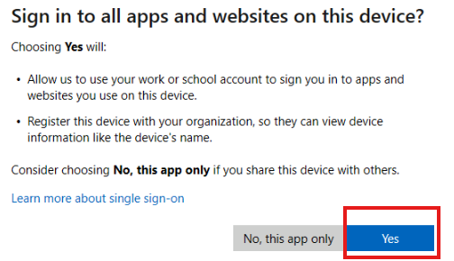
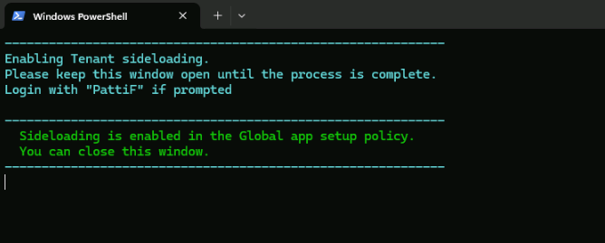
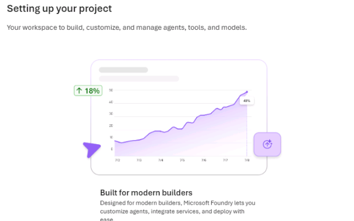
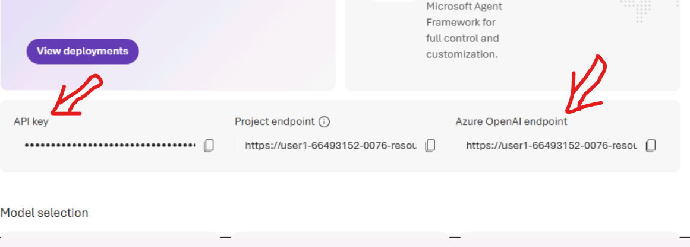
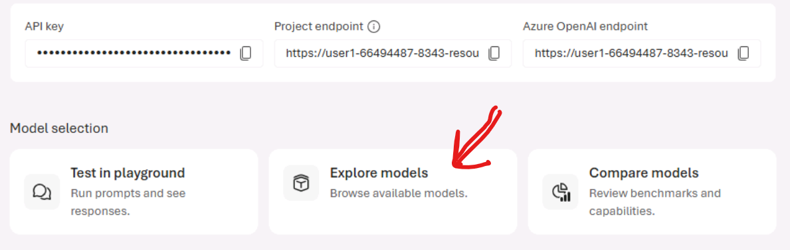
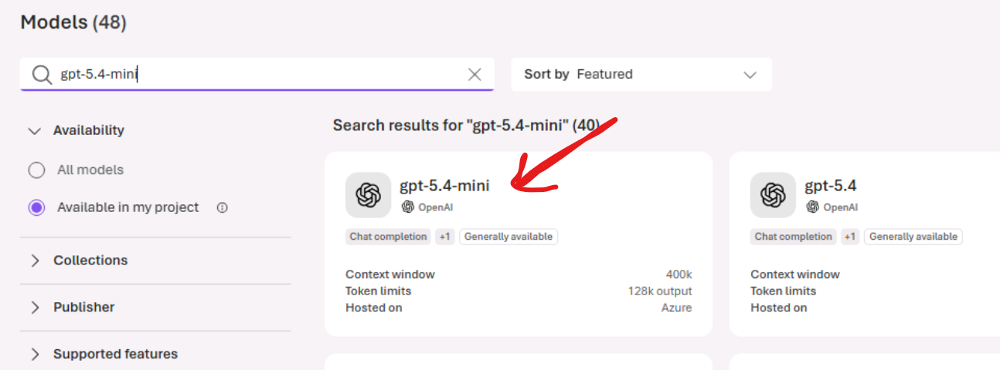
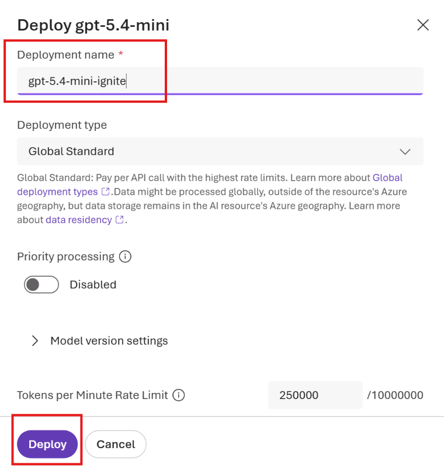

# Exercise 0: Build your First Agent & Connect AI Resources

In this exercise, you will:

1.  Set up your M365 Enterprise tenant to accept sideloaded apps
2.  Set up your development environment
3.  Configure the agent to use Azure OpenAI with Microsoft Foundry
4.  Run the agent locally with Agents Playground

---

### Step 1: Enable Sideloading apps and agents for the Tenant

> This sideloading script will make changes to your M365 tenant to allow users to upload custom apps (also known as sideloading). Since we aren't publishing our agent to the store, this is how we will use our agent in Teams.

1. [ ] Log in to Windows using the following password:

   `@lab.VirtualMachine(Win11-Pro-Base).Password`

2. [ ] Click **Start** and run the shortcut: **Enable Sideloading**.

   > This script may take up to 45 seconds to initialize

3. [ ] Sign in using the following username & TAP (password):
   - Username: `PattiF@@lab.CloudCredential(WWLM365E7).TenantName`
   - TAP (Temporary Access Pass): `@lab.CloudCredential(WWLM365E7).PattiFTAP`

   If prompted, select **Yes**. Wait for the account to be added to the device, then select **Done**. Wait ~45 sec after you sign in for the script to execute.

   

   Once the script finishes, it will indicate that sideloading is enabled.

   

4. [ ] Close the Terminal

---

### Step 2: Set up your development environment

> The `.env` file contains all of the variables your agent needs to connect to AI resources, as well as connect to Teams services to facilitate conversations. These files are typically hidden to prevent leaking API keys and other secrets.

1. [ ] Open **VS Code** from the **Start Menu**.
   - The Ignite Lab `.env` file should load automatically.

2. [ ] In the project directory, verify that `index.ts` under `src` is accessible.

3. [ ] Review the `.env` file to understand its configuration. This is where we'll input our Azure OpenAI key and client secrets later.

---

### Step 3: Configure the agent to use Azure OpenAI with Microsoft Foundry

> Microsoft Foundry & Azure OpenAI are acting as the LLM provider for your agent. When users make requests to your agent, the requests are routed to this LLM provider for processing and response.

1. [ ] Open the Microsoft Edge profile for `Azure Admin` from the **Start Menu**.
2. [ ] Navigate to `ai.azure.com/nextgen`
3. [ ] Sign in using the following username:

   `@lab.CloudPortalCredential(User1).Username`

4. [ ] Authenticate using the following TAP (Temporary Access Pass):

   `@lab.CloudPortalCredential(User1).AccessToken`

5. [ ] Wait for Microsoft Foundry to complete the setup process (this will take ~1 minute).

   

   > If a post-setup welcome pop-up appears in Microsoft Foundry, select **Skip** to continue.

6. [ ] Copy the **[API key]** and **[Azure OpenAI endpoint]** from the appropriate section in the portal.

   

7. [ ] In Visual Studio Code, open the `.env` file and update it with the values copied from your Azure Foundry resource, as shown below:

   ```dotenv
   AZURE_OPENAI_API_KEY=5kiBiDOuzD....sws7&X
   AZURE_OPENAI_ENDPOINT=https://domain.openai.azure.com/openai/v1
   ```

8. [ ] Save the `.env` file after making any updates.

   > **Tip:** You can save the file by pressing `Ctrl + S`.

---

> Your API key and URI provide a connection to the resources provided by your LLM provider. You are not limited to using Azure OpenAI with the Teams SDK.

1. [ ] In Microsoft Foundry, navigate to **Explore Models**.

   

2. [ ] Search for `gpt-5.4-mini`

   > **Warning:** gpt-5.4-mini is the only model available for deployment in this lab's Azure Subscription.
   >
   > 
   >

3. [ ] Open the **gpt-5.4-mini** model details page, then select Custom Deploy.

   > If the **Custom Deploy** button is not available, select **Deploy > Custom Settings**.

4. [ ] Set the Deployment Name to `gpt-5.4-mini-ignite`

5. [ ] Leave all the other parameters at their default values without changing anything else, and deploy the model by clicking **Deploy**.

   

   > The value `gpt-5.4-mini-ignite` is already set in the `.env` file. If you use a different deployment name, please update the `.env` file.

6. [ ] Close the Edge Browser for Azure Admin.

---

Congrats, you just connected your agent to a model! :tada:

---

**Please proceed to the next section.**

---

