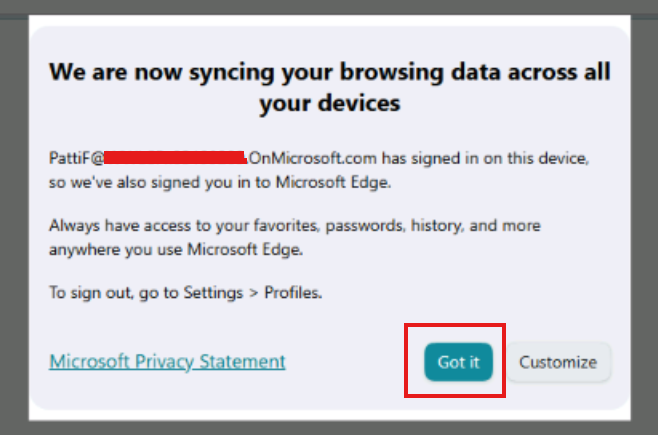
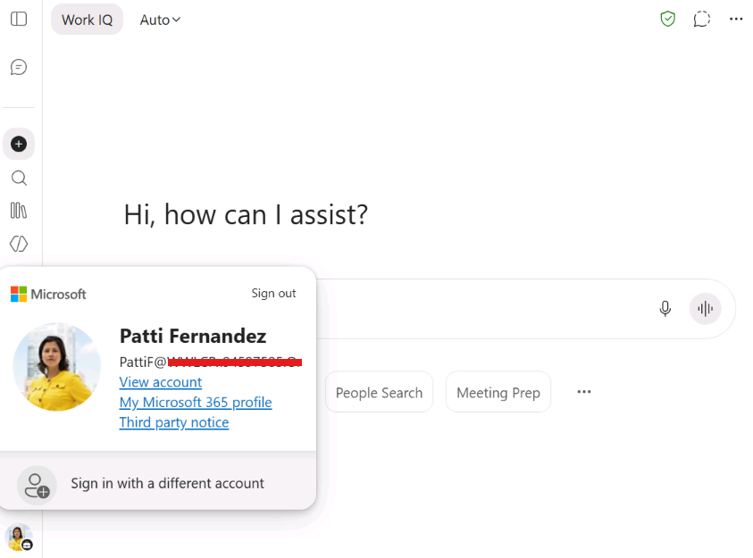
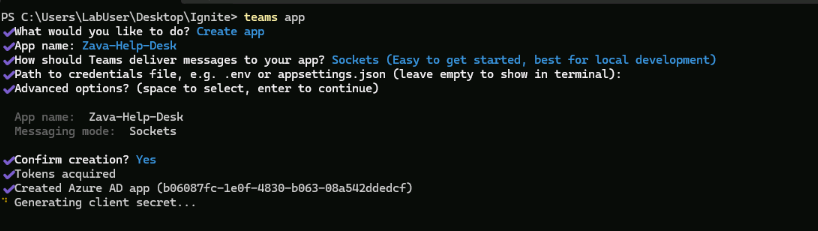
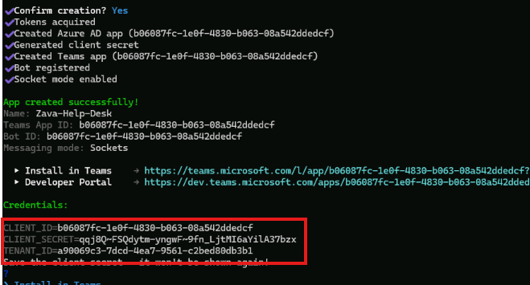
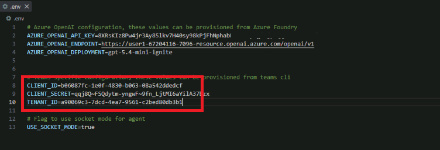
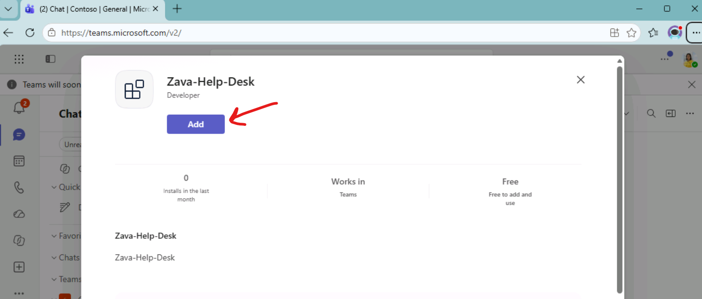

# Exercise 1: Bring Your Agent to Microsoft Teams

In this exercise, you will:

1.  Set up Teams CLI
2.  Create a Teams app registration
3.  Sideload your agent in 1:1 chat

---

### Step 1: Set up Teams CLI

> In the following steps, you will start using the Teams CLI. Teams CLI is a collection of tools available to help developers build and modify their agent settings without having to leave their development environment. It also allows programmatic access to these tools via coding agents.

1. [ ] Open the Microsoft Edge profile for `PattiF` from the **Start Menu**.

   > If Edge displays this notification, click 'Got it'.

   

2. [ ] Navigate to `portal.office.com`

   If prompted, log in with:

   `PattiF@@lab.CloudCredential(WWLM365E7).TenantName`

   Authenticate using the following TAP (Temporary Access Pass):

   `@lab.CloudCredential(WWLM365E7).PattiFTAP`

   Once you have signed in as `PattiF`, **close the browser**.

   

---

1. [ ] Open **Terminal** from the **Start Menu**.

2. [ ] Run the following command to log in to Teams CLI:

   `teams login`

   It should open the browser and log you in automatically. If prompted, use the credentials from **Step 1**.

   > When the browser _says Authentication successful!_, you can close the browser

3. [ ] Run the following command to log in to Azure CLI (you can use the same terminal):

   `az login --allow-no-subscriptions`

   > Teams CLI uses resources across your tenant and Azure subscriptions. We log in to all these services so the CLI can take action across services and save developers the headache of working in multiple systems.

4. [ ] Select the following user and continue:

   `PattiF@@lab.CloudCredential(WWLM365E7).TenantName`

   > If prompted for a TAP, use the following: `@lab.CloudCredential(WWLM365E7).PattiFTAP`

5. [ ] After logging in, you should see Select Subscription.

   > Select a subscription and tenant (Type a number or Enter for no changes):

   Press Enter and continue

---

### Step 2: Create a Teams app registration

> The agent in this demo uses a bot registration behind the scenes. Your Client ID and Secret are tied to your bot registration and bridge the connection between your running code and the bot registration.

1. [ ] Run the following command to launch the Teams CLI:

   `teams app`

2. [ ] Select **Create App**. (↑↓ navigate • ⏎ select)
3. [ ] Enter `Zava-Help-Desk` as the app name.
4. [ ] **How should Teams deliver messages to your app?** : Select [**by pressing Enter**]

   _Sockets (Easy to get started, best for local development)_

5. [ ] Path to credentials file : **Do not type anything, press ENTER and continue**

6. [ ] Advanced options? : **Do not type anything, press ENTER and continue**

7. [ ] Confirm creation? : **Type Y and ENTER**

   

8. [ ] Wait for the app process to complete. Copy the generated output values into the `.env` file in your codebase.

   ```dotenv
   CLIENT_ID=generated_client_id
   CLIENT_SECRET=generated_client_secret
   TENANT_ID=generated_tenant_id
   ```

   Replace the placeholders with the actual values generated by the CLI.

   

9. [ ] Update the `.env` file in VS Code.

   

   > **Tip:** Remember to save the `.env` file after making any updates by pressing `Ctrl + S`.

10. [ ] After updating the environment variables, start the server by running the following command in the VS Code terminal:

    `npm run dev`

    > **Tip:** The terminal should already be open in VS Code. If not, open it by pressing **Ctrl + Backtick**.

11. [ ] Wait ~1 minute until the terminal displays:

    `Socket Mode ready (inbound activities over WebSocket)`

12. [ ] Go back to the Teams CLI and select **Install in Teams**. This should launch Teams in the browser.
13. [ ] Select **Use the web app instead**.
14. [ ] Sign in using the following username (If prompted):

    `PattiF@@lab.CloudCredential(WWLM365E7).TenantName`

    Authenticate using the following TAP (Temporary Access Pass):

    `@lab.CloudCredential(WWLM365E7).PattiFTAP`

15. [ ] Select Add to add the agent in Teams. Once added, click `Open`.

   

   > **Tip:** If you don't see the **Add** button, wait ~1 minute. Teams might still be loading.

---

### Step 3: Sideload your agent in 1:1 chat

1. [ ] Once the Teams agent loads, test the agent by interacting with it.

2. [ ] Use the following sample prompts:
   - `Hi`
   - `What can you do?`

3. [ ] After completing the tests, do the following:
   - Close the Microsoft Edge browser window.
   - Close the terminal window running the Teams CLI.
   - In VS Code, stop the locally running agent process by pressing `Ctrl + C` in the terminal.

---

Congratulations, you've taken your agent from running in a local environment to running in Teams :tada: <br>
**Please proceed to the next section.**

---

