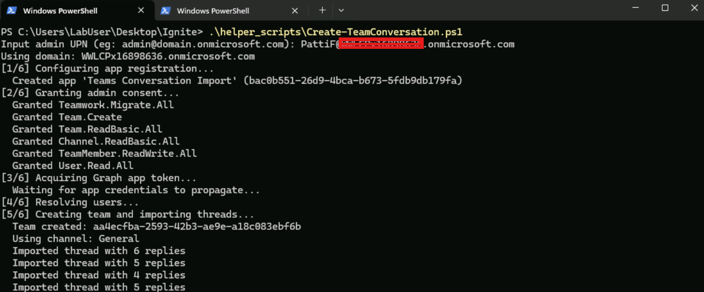
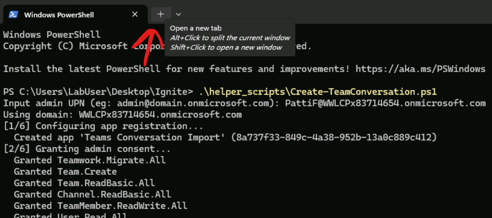
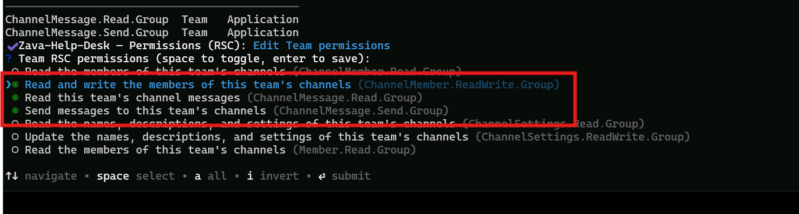
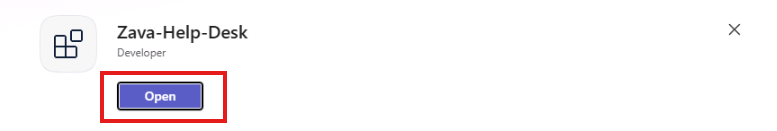
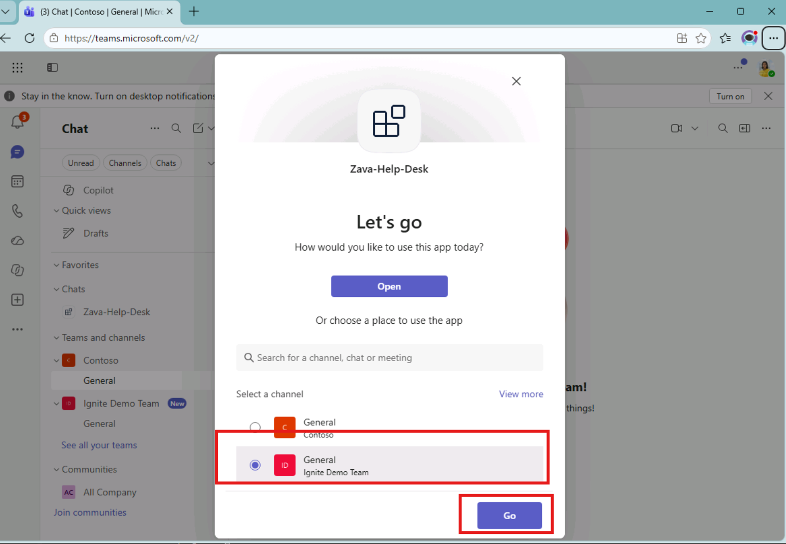
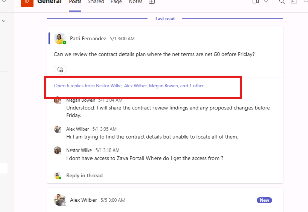
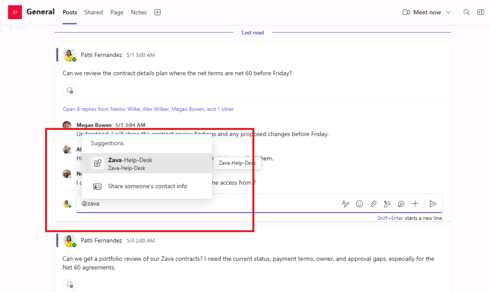
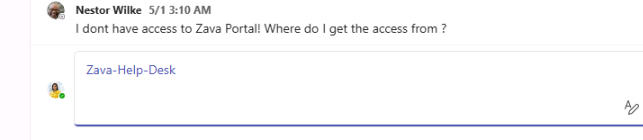
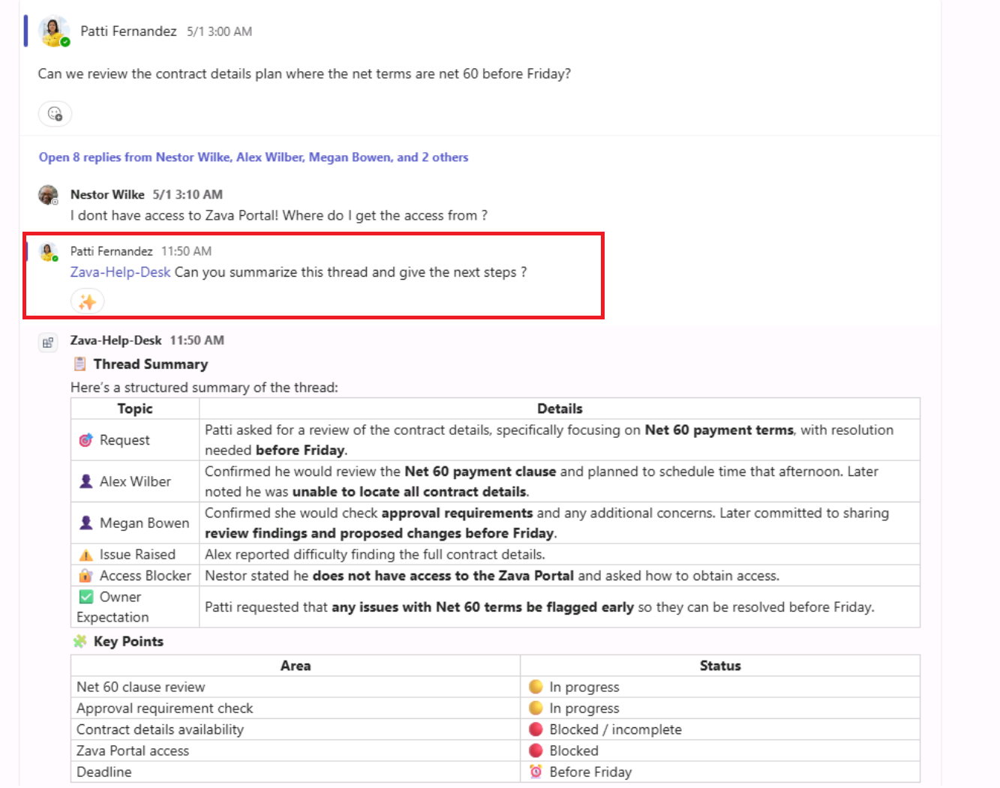
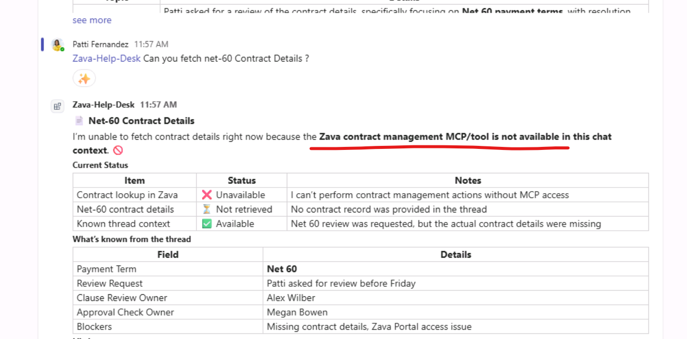

# Exercise 2: Enable Collaboration

In this exercise, you will:

1.  Create mock data in your M365 Enterprise tenant
2.  Update RSC permissions for your agent
3.  Add your agent to a channel & run your agent
4.  Enable @mentions, thread reading, and summaries
5.  Test external data fetching
6.  Clean up your environment

---

### Step 1: Create mock data in your M365 Enterprise tenant

1. [ ] To test collaborative agents, we need conversations involving multiple users.
2. [ ] The script below will create mock conversations and a Teams channel that will be used in later steps.
3. [ ] Open a new terminal from the **Start Menu**.
4. [ ] Run the following PowerShell script:

   `.\helper_scripts\Create-TeamConversation.ps1`

5. [ ] When prompted for details, enter the following username:

   `PattiF@@lab.CloudCredential(WWLM365E7).TenantName`

6. [ ] You can proceed to the next step while the script continues running in the background. Do not close this terminal until the script finishes. This takes ~2 minutes.

   

---

### Step 2: Update RSC permissions for your agent

> In this step, adding RSC permissions to your agent allows it to view and interact with messages in channels. By default, agents can only see messages where the agent has been @mentioned. RSC helps expand that to allow the agent to see all messages in a channel without granting access to every message in your organization.

1. [ ] Open a New Terminal Tab

   

2. [ ] Launch the Teams CLI by running:

   `teams app`

3. [ ] Navigate to **Select App**.

4. [ ] Select `Zava-Help-Desk`

5. [ ] Navigate to **Permissions (RSC)**. You can use ↑↓ navigate • ⏎ select

6. [ ] Select **Edit Team Permissions**.

7. [ ] Add the following permissions (see the hint below on how to add these easily):
   - `ChannelMember.ReadWrite.Group`
   - `ChannelMessage.Read.Group`
   - `ChannelMessage.Send.Group`

   > **Tip:** The permissions are in the 9th, 10th, and 11th positions. Press 9 to jump to the 9th position, then select that permission (using space) and the next two. Use ↑ / ↓ to navigate, Space to select each permission, and Enter to submit once all three permissions are selected.

   

8. [ ] Apply the RSC permissions by entering _Y_.

---

### Step 3: Add your agent to a channel & run your agent

> This step may seem repetitive. Every time you change permissions on your agent, it needs to be restarted and reinstalled to grant the new permissions.

1. [ ] In the same CLI, navigate **Back** > select **Get App Details**.

2. [ ] Select **Install in Teams**. This will launch the browser. Select **Use the web app instead**.

3. [ ] Install the app in the **Ignite Demo Team**.

   

   

4. [ ] Minimize Edge and open **VS Code**

5. [ ] In the Terminal, start the server by running

   `npm run dev`

6. [ ] Wait ~1 minute until the terminal displays:

   `Socket Mode ready (inbound activities over WebSocket)`

---

### Step 4: Enable @mentions, thread reading, and summaries.

1. [ ] Go back to Edge and open the **Ignite Team**, which already contains conversation threads.
2. [ ] Navigate to the top of the messages.

   > **Tip:** You can maximize a thread by clicking _Open X replies_
   >
   > 
   >

3. [ ] Start by @mentioning the agent in a Teams thread.

   

4. [ ] In the thread titled _"Can we review the contract....."_, ask the agent to summarize the conversation and provide the next steps. Use the following prompt (press Send after typing the prompt):

   `Can you summarize this thread and give the next steps ?`

   > **Tip:** Make sure to @mention and resolve the agent name before entering this prompt.
   >
   > 
   >

5. [ ] The agent should acknowledge the message by replying with an emoji.
6. [ ] Once processing is complete, the agent will reply with a summary of the conversation.

   

---

### Step 5: Test external data fetching

1. [ ] In the same conversation thread, @mention the agent and ask it to fetch the contract details using the following prompt:

   `Can you fetch net-60 Contract Details from Zava System ?`

   > **Tip:** Make sure to @mention the agent and select its name from the suggestions before submitting the prompt.

2. [ ] The agent **should refuse** this request because it is not yet connected to an external MCP server.

   

   > **Tip:** This is expected behavior, as we've defined the agent's instructions in `src\azureOpenAi\agentInstruction.md`. If the agent cannot retrieve external information, it should not hallucinate or make things up. In the next exercise, we'll connect the agent to MCP.

---

### Step 6: Cleanup

1. [ ] After completing the tests, perform the following cleanup steps:
   - **Minimize** the Edge window for PattiF.
   - Close the terminal window running the Teams CLI.
   - Close the terminal window running the Helper Conversation Script.
   - In VS Code, stop the locally running agent process by pressing **Ctrl + C** in the terminal.

---

---

