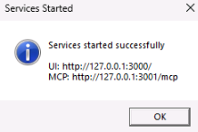
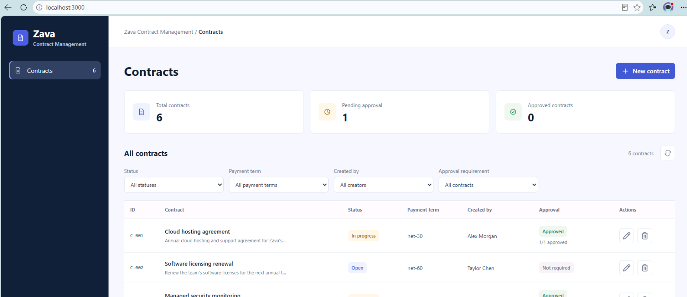
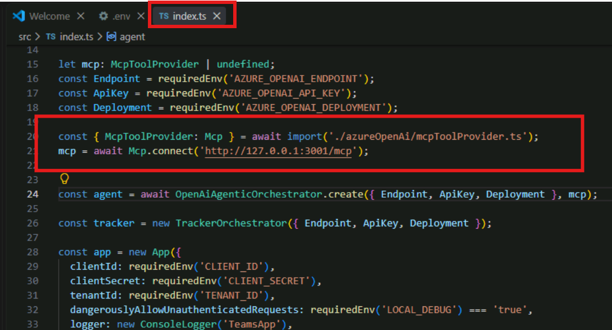
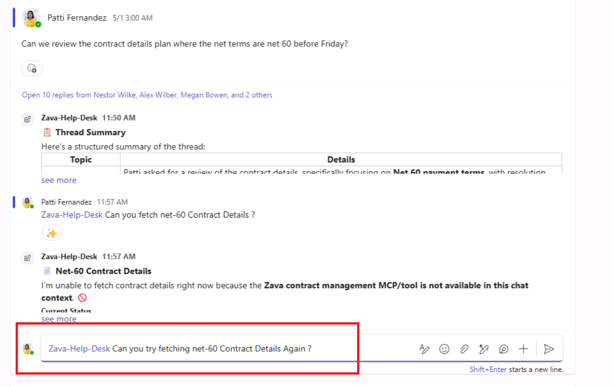
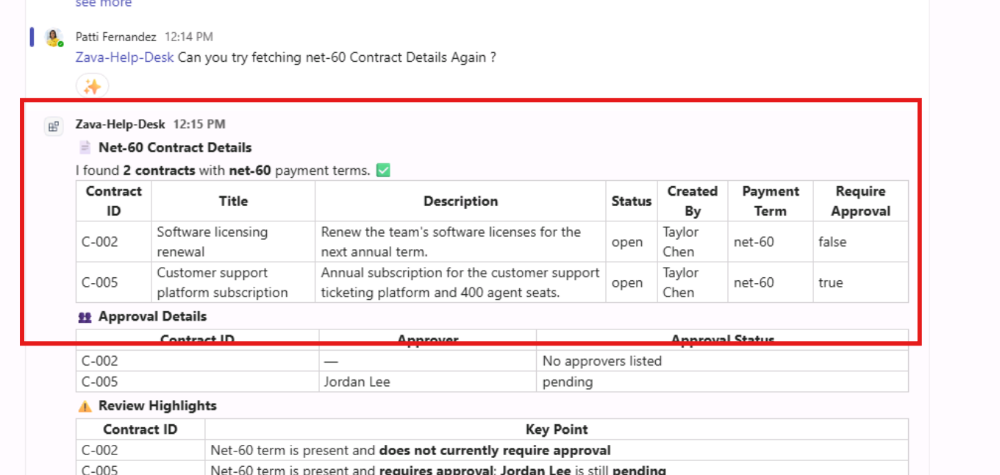
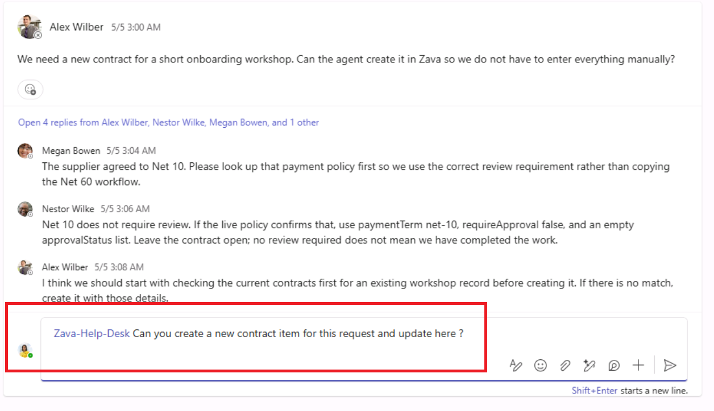
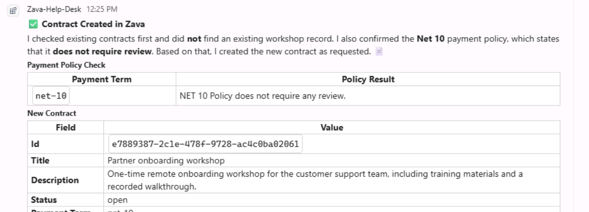
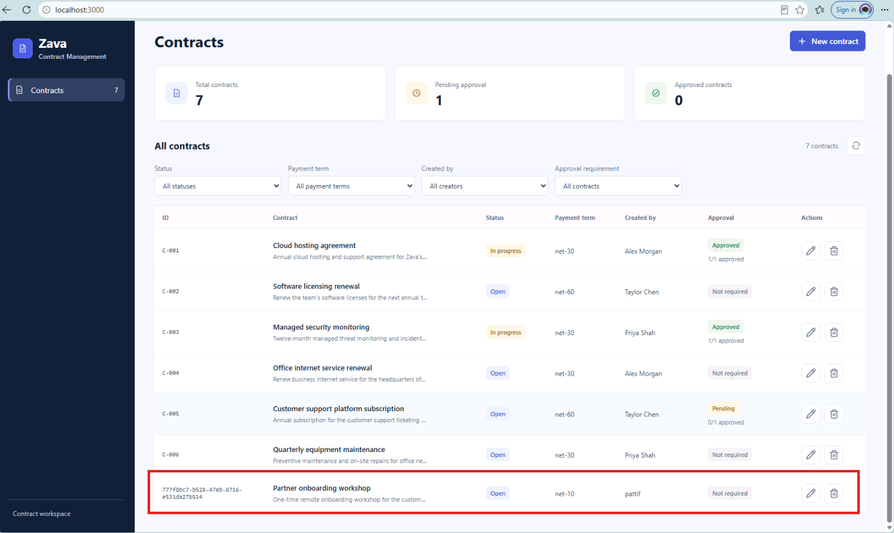

# Exercise 3: Connect the Agent to External Tools

In this exercise, you will connect the agent to an MCP server to enable it to interact with the Contract Management System.

---

### Step 1: Explore the Contract Management System

> Zava Contract Services is an MCP server running locally on your machine. Outside of this lab, you would use a public MCP server or one you create and host yourself to enable the use of available MCP tools.

1. [ ] Open the **Start Menu** and launch **Zava Contract Services**.

   

2. [ ] Open a new tab in the browser and navigate to `localhost:3000`
3. [ ] Explore the UI of the Contract Management application and make sure you can see the list of contracts.

   

---

### Step 2: Connect the MCP Server to the Agent

> In this step, the connection to the MCP server has been written for you (lines 20 & 21). Uncommenting the code allows the agent to connect now that you have started the server in Step #1 above.

1. [ ] Open the agent codebase in VS Code.
2. [ ] Open the `index.ts` file.
3. [ ] Uncomment lines 20 and 21 to connect the MCP server to the application.

   

4. [ ] Save the file (use CTRL + S).
5. [ ] Start the server by running the following command in the terminal:

   `npm run dev`

6. [ ] Wait ~1 minute until the terminal displays:

   `Socket Mode ready (inbound activities over WebSocket)`

---

### Step 3: Fetch Contracts from an External Source

> In this step, we are explicitly telling our agent to use the MCP tools available to it. This helps us ensure consistency in the lab environment. Outside of this lab, your agent will reason over requests and decide whether using MCP tools makes sense in those cases.

1. [ ] Return to the same thread from the previous exercise, where the agent was unable to fetch the contract details.
2. [ ] Ask the agent to fetch the details again using the prompt shown below.

   `try again and fetch net-60 details, retry the tool call`

   > **Tip:** Make sure to @mention the agent and select its name from the suggestions before submitting the prompt.

   

3. [ ] This time, the agent should be able to fetch the contract details from the contract management system.

   

4. [ ] **(Optional)** Open the UI in a separate tab by navigating to `localhost:3000`. Verify the accuracy of the retrieved details by comparing the Net-60 contract details displayed in the UI with the data retrieved by the agent.

---

### Step 4: Create New Contracts

1. [ ] Look for the thread in the channel created by **Alex Wilber**.
2. [ ] @mention the agent and ask it to create a new contract item using the following prompt:

   `Can you create a new contract item for this request and update here ?`

   > **Tip:** Make sure to @mention the agent and select its name from the suggestions before submitting the prompt.

   

3. [ ] The agent should create a new item and respond in the thread.

   

4. [ ] **(Optional)** Open the UI in a separate tab to verify that the item was created successfully. Open `localhost:3000` and verify the new item.

   

---

---

