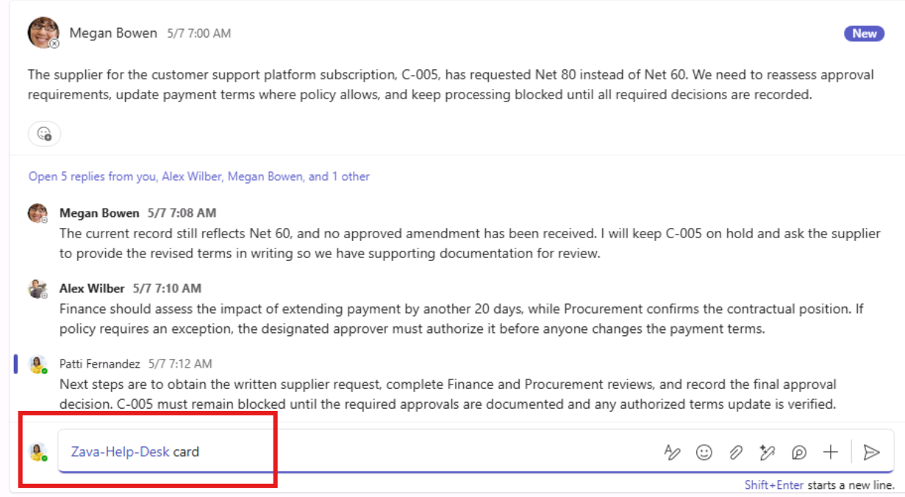
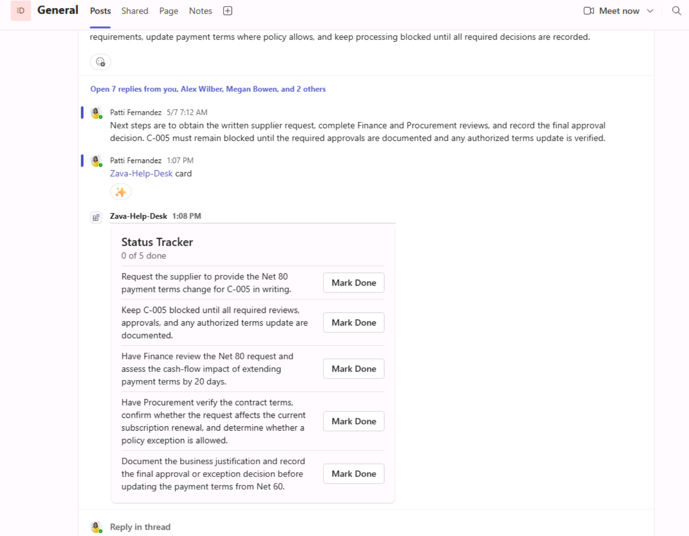
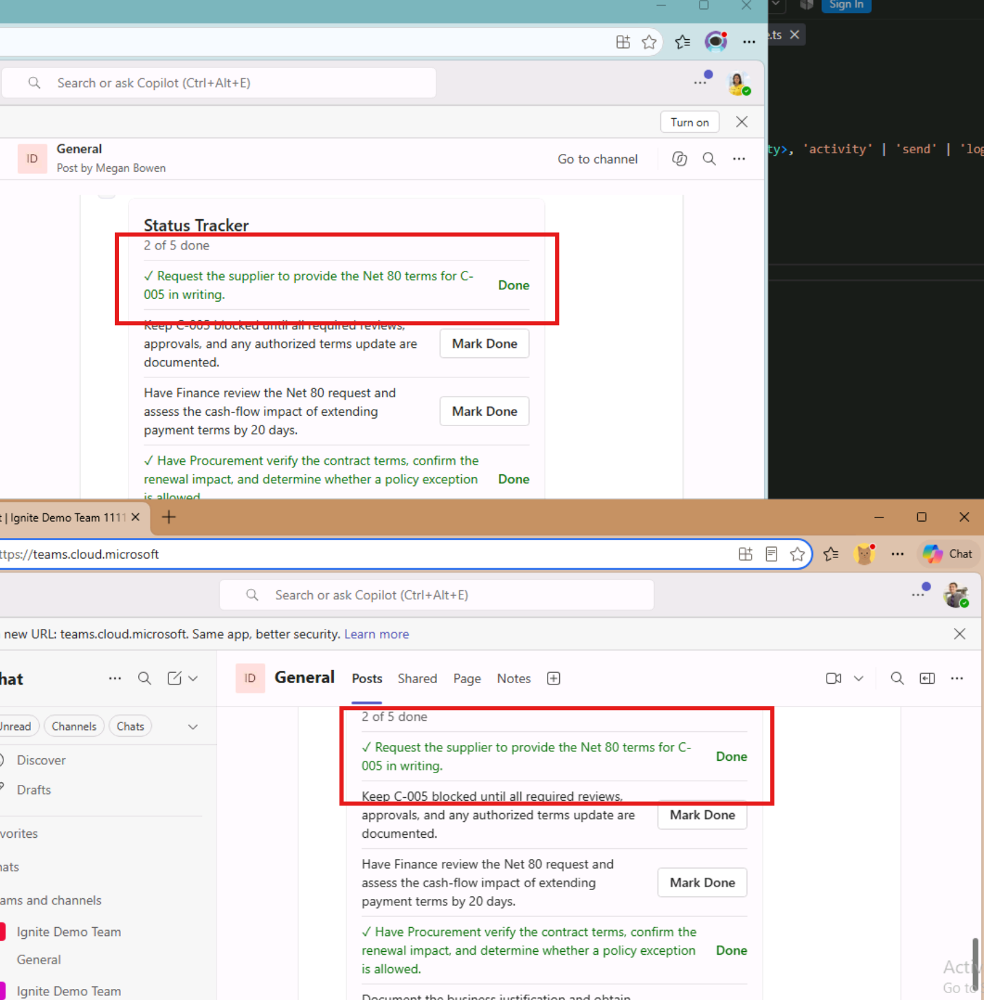

# Exercise 4: Generate Interactive Adaptive Cards

In this exercise, you will enhance the agent to generate interactive Adaptive Cards in Microsoft Teams. When you @mention the agent and ask it to create a card, it will render an interactive card that users can interact with and update dynamically.

The card will contain 5 action items based on the thread context, and users will be able to update the card in real time.

---

### Step 1: Test Interactive Adaptive Cards

> In this step, we'll use different accounts so you can see how adaptive cards can be utilized by users across your organization.

1. [ ] Find the thread in the channel created by **Megan Bowen**.
2. [ ] @mention the agent and enter exactly `card`

   

3. [ ] The agent should respond with an interactive Adaptive Card.

   

4. [ ] Interact with the generated card by clicking the buttons. The card should update to mark the selected items as **Done**.

5. [ ] From the **Start Menu**, open the Microsoft Edge profile for `AlexW` and navigate to Teams using the following URL:

   `https://aka.ms/mstfw`

6. [ ] Sign in using the following credentials:

   - **Username:** `AlexW@@lab.CloudCredential(WWLM365E7).TenantName`
   - **TAP:** `@lab.CloudCredential(WWLM365E7).AlexWTAP`

   Skip any Teams messages prompting you to install the app or complete the getting-started steps.

7. [ ] Navigate to the same team, **Ignite Demo Team**, and interact with the card.

8. [ ] Notice how updates made to the card by one user are reflected for the other user as well.

   

---

### Step 2: Explore Adaptive Card Rendering logic

1. [ ] Open the agent codebase in VS Code and navigate to `statusTrackerCard`, where the Adaptive Card rendering logic is already implemented. Review the files in this folder to understand how the functionality is organized and identify the components involved in preparing and displaying the card.

2. [ ] Open `eventHandler.ts` and look around line 62 for the logic that handles the `card` prompt. Examine how the incoming message is checked and follow the function call that routes the request to the status tracker flow.

3. [ ] Open `trackerOrchestrator.ts` and review the functions invoked by the event handler. Follow their execution order to understand how the orchestrator coordinates the flow and passes information to the card rendering components.

4. [ ] Follow the relevant calls into the rendering logic inside `statusTrackerCard`. Explore how the card's layout, content, and displayed values are assembled, then trace how the completed card is returned or sent to the conversation.

---

---

