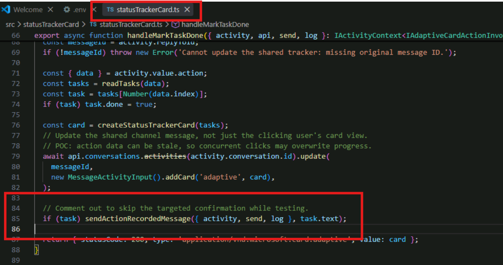
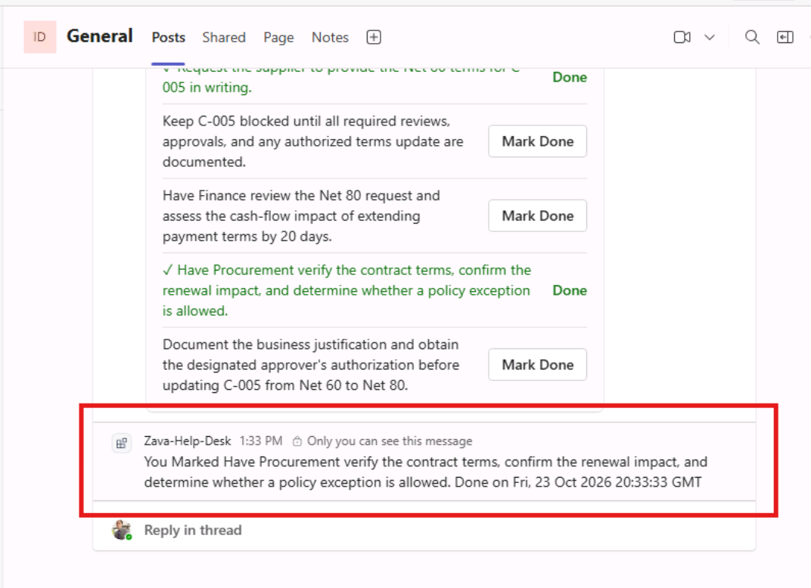

# Exercise 5: Send Targeted Messages from Adaptive Card Interactions

In this exercise, you will enhance the agent to send targeted messages when a user interacts with an Adaptive Card in Microsoft Teams. The response should be visible only to the user who performed the action, without notifying other participants in the conversation.

---

### Step 1: Explore the Targeted Messaging Logic

1. [ ] In VS Code, stop the running server by pressing **Ctrl + C** in the terminal.
2. [ ] Open `src\statusTrackerCard\statusTrackerCard.ts` and uncomment **line 85**.

   

3. [ ] The implementation for targeted messaging is already available in `src\targetedMessage\sendActionRecordedMessage.ts`.
4. [ ] Start the server by running the following command in the terminal:

   `npm run dev`

5. [ ] Wait approximately one minute for the terminal to display:

   `Socket Mode ready (inbound activities over WebSocket)`

---

### Step 2: Test Targeted Messages

1. [ ] Have either user interact with the card again.

2. [ ] After the interaction, a targeted message should be posted. This message should be visible only to the user who interacted with the card.

3. [ ] Verify this with the other user. The targeted message should not be visible to them.

   

---

---

