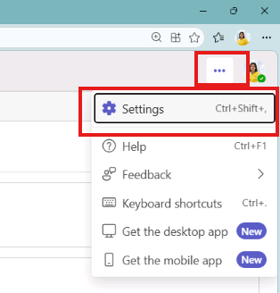
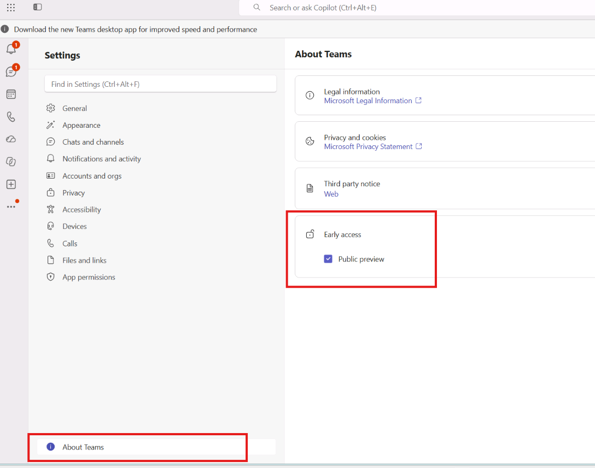
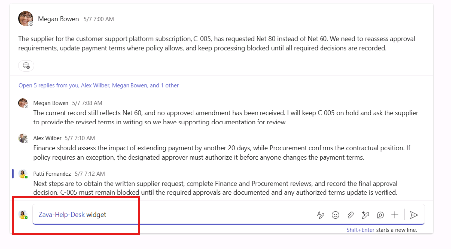
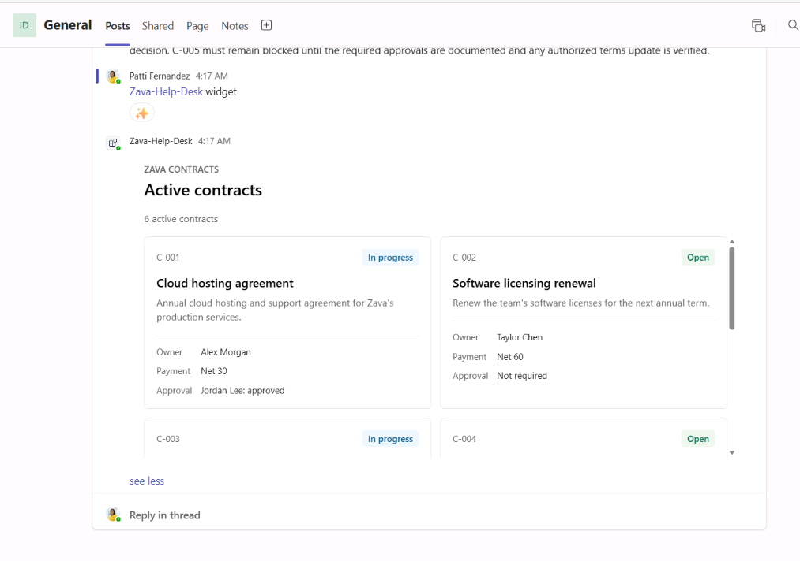

# Exercise 6: Render HTML Widgets

In this exercise, you will enhance the agent to render an HTML widget to bring a custom HTML interface into a conversation.

---

> HTML widgets are a preview feature. The Teams SDK marks the related APIs as experimental, and they may change.

### Step 1: Enable Preview Features

1. [ ] On the Teams client, click the three dots (⋯) next to your profile picture, then navigate to Settings.

   

2. [ ] Go to About Teams and check the "Public Preview" checkbox.

   

3. [ ] Once the box is checked, open the URL below in the same browser tab. This will refresh Teams.

   `https://teams.cloud.microsoft/?ring=ring3_6`

   Teams is now enabled for preview features.

---

### Step 2: Test the HTML widget

1. [ ] Navigate to the Ignite Demo Team
2. [ ] In any thread @mention the agent and enter exactly `widget`

   

3. [ ] The agent should render an HTML widget.

   

---

### Step 3: Explore Widget Rendering logic

1. [ ] Triggered by widget: When a channel @mention contains exactly widget after removing mentions, `eventHandler.ts:74` calls `createMcpWidgetMessage()` and sends its response.

2. [ ] Fetches data and HTML: `widgetHtmlMcp.ts:6` connects to the local MCP server at `http://127.0.0.1:3001/mcp`, calls its widget tool, and reads the HTML resource `ui://widget/active-contracts.html`.

3. [ ] Packages the Teams widget: It combines the HTML, tool output, MCP URL, and security policy into a widget/mcp-ui payload. It serializes this into an html-widget code block within an extended-Markdown Teams message.

4. [ ] Handles failures and cleanup: If connecting, fetching, or processing fails, it returns a plain-text message asking users to ensure Zava Contract Services are running. It always attempts to close the MCP client afterward.

---

---

