# Build AI Agents in Teams [Ignite 2026 Lab]

## Overview

Most agentic interactions take place in a one-to-one chat. In this lab, you will create an agent that primarily works in collaborative spaces like group chats and channels in Microsoft Teams. Today you'll create an agent that achieves the following:

- Read channel conversations and summarize threads.
- Pull live data from an external contract management system through MCP.
- Post shared Adaptive Cards that the whole channel can update.
- Send targeted messages to the person who took an action on an adaptive card.

We'll build this agent in a real Microsoft 365 Enterprise tenant with an Azure OpenAI key. You'll leave this lab with a fully functional collaborative agent you can reuse to help create your own Teams agent. This agent was built using the Teams SDK. The Teams SDK is available in TypeScript, .NET, and Python.

---

## Lab Breakdown

This lab is divided into 7 exercises:

### Exercise 0: Build your First Agent & Connect AI Resources

- Bootstrap your new agent
- Open your agent code
- Configure your Azure OpenAI LLM key
- Run the agent in Agents Playground

### Exercise 1: Bring Your Agent to Teams

- Set up a development tunnel
- Create a Teams app registration
- Sideload it in 1:1 chat
- Test streaming

### Exercise 2: Enable Collaboration

- Update RSC permissions
- Add the agent to a channel
- Test @mentions, thread reading, and summaries

### Exercise 3: Connect Tools via MCP

- Integrate contract management via MCP

### Exercise 4: Create Shared Checklists

- Generate a five-point checklist from conversation context
- Post the checklist as an Adaptive Card
- Sync updates across channel members

### Exercise 5: Send Targeted Notifications

- Notify users when checklist items are updated via private targeted messages

### Exercise 6: Render HTML Widgets

- Display a summary of current contracts in the system as HTML widgets

---

**Please proceed to the next section.** (Navigation aids are at the bottom right)

---

> **Note:** This lab is written in TypeScript. No prior knowledge is needed.

> **Help:** **If you are stuck in any part of the lab, please raise your hand to ask a proctor for help.**

---

## Exercise 0: Build your First Agent & Connect AI Resources

In this exercise, you will:

1.  Set up your M365 Enterprise tenant to accept sideloaded apps
2.  Set up your development environment
3.  Configure the agent to use Azure OpenAI with Microsoft Foundry
4.  Run the agent locally with Agents Playground

---

### Step 1: Enable Sideloading apps and agents for the Tenant

> This sideloading script will make changes to your M365 tenant to allow users to upload custom apps (also known as sideloading). Since we aren't publishing our agent to the store, this is how we will use our agent in Teams.

1. [ ] Log in to Windows using the following password:

   `@lab.VirtualMachine(Win11-Pro-Base).Password`

2. [ ] Click **Start** and run the shortcut: **Enable Sideloading**.

   > This script may take up to 45 seconds to initialize

3. [ ] Sign in using the following username & TAP (password):
   - Username: `PattiF@@lab.CloudCredential(WWLM365E7).TenantName`
   - TAP (Temporary Access Pass): `@lab.CloudCredential(WWLM365E7).PattiFTAP`

   If prompted, select **Yes**. Wait for the account to be added to the device, then select **Done**. Wait ~45 sec after you sign in for the script to execute.
   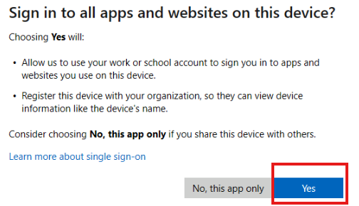

   Once the script finishes, it will indicate that sideloading is enabled.
   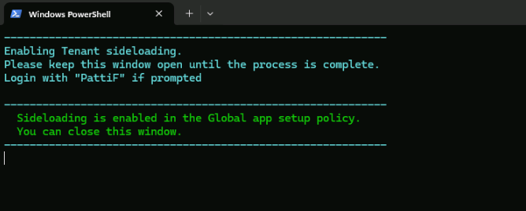

4. [ ] Close the Terminal

---

### Step 2: Set up your development environment

> The `.env` file contains all of the variables your agent needs to connect to AI resources, as well as connect to Teams services to facilitate conversations. These files are typically hidden to prevent leaking API keys and other secrets.

1. [ ] Open **VS Code** from the **Start Menu**.
   - The Ignite Lab `.env` file should load automatically.

2. [ ] In the project directory, verify that `index.ts` under `src` is accessible.

3. [ ] Review the `.env` file to understand its configuration. This is where we'll input our Azure OpenAI key and client secrets later.

---

### Step 3: Configure the agent to use Azure OpenAI with Microsoft Foundry

> Microsoft Foundry & Azure OpenAI are acting as the LLM provider for your agent. When users make requests to your agent, the requests are routed to this LLM provider for processing and response.

1. [ ] Open the Microsoft Edge profile for `Azure Admin` from the **Start Menu**.
2. [ ] Navigate to `ai.azure.com/nextgen`
3. [ ] Sign in using the following username:

   `@lab.CloudPortalCredential(User1).Username`

4. [ ] Authenticate using the following TAP (Temporary Access Pass):

   `@lab.CloudPortalCredential(User1).AccessToken`

5. [ ] Wait for Microsoft Foundry to complete the setup process (this will take ~1 minute).

   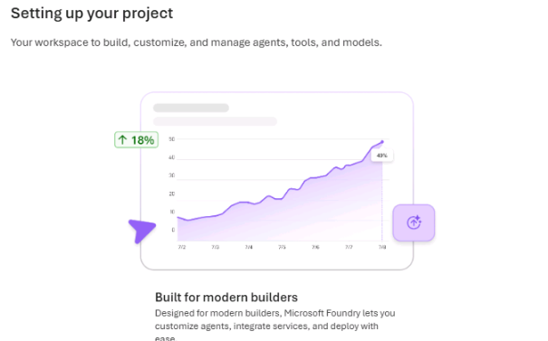

   > If a post-setup welcome pop-up appears in Microsoft Foundry, select **Skip** to continue.

6. [ ] Copy the **[API key]** and **[Azure OpenAI endpoint]** from the appropriate section in the portal.

   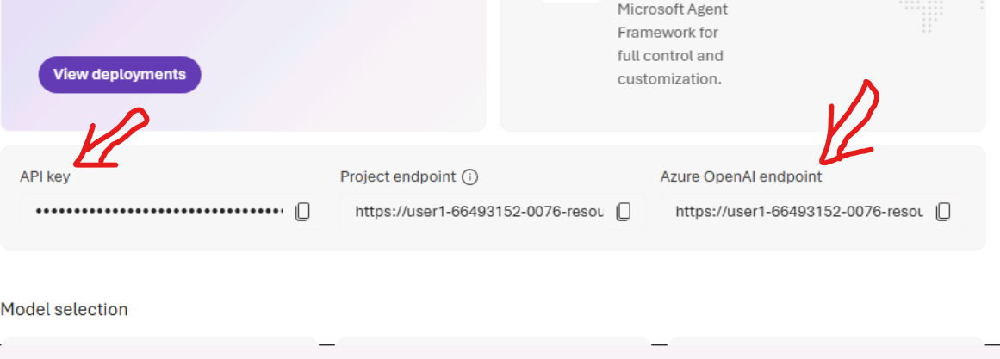

7. [ ] In Visual Studio Code, open the `.env` file and update it with the values copied from your Azure Foundry resource, as shown below:

   ```dotenv
   AZURE_OPENAI_API_KEY=5kiBiDOuzD....sws7&X
   AZURE_OPENAI_ENDPOINT=https://domain.openai.azure.com/openai/v1
   ```

8. [ ] Save the `.env` file after making any updates.

   > **Tip:** You can save the file by pressing `Ctrl + S`.

---

> Your API key and URI provide a connection to the resources provided by your LLM provider. You are not limited to using Azure OpenAI with the Teams SDK.

1. [ ] In Microsoft Foundry, navigate to **Explore Models**.

   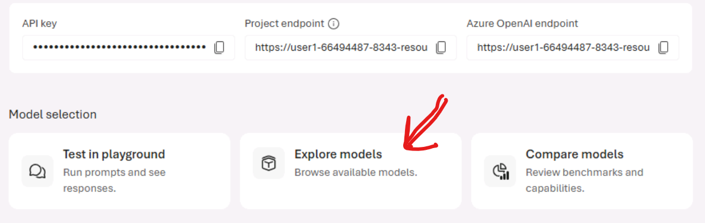

2. [ ] Search for `gpt-5.4-mini`

   > **Warning:** gpt-5.4-mini is the only model available for deployment in this lab's Azure Subscription.
   > 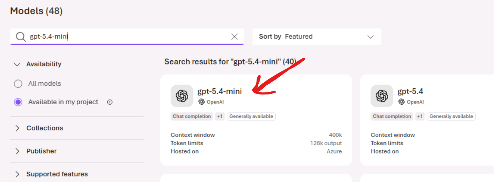

3. [ ] Open the **gpt-5.4-mini** model details page, then select Custom Deploy.

   > If the **Custom Deploy** button is not available, select **Deploy > Custom Settings**.

4. [ ] Set the Deployment Name to `gpt-5.4-mini-ignite`

5. [ ] Leave all the other parameters at their default values without changing anything else, and deploy the model by clicking **Deploy**.

   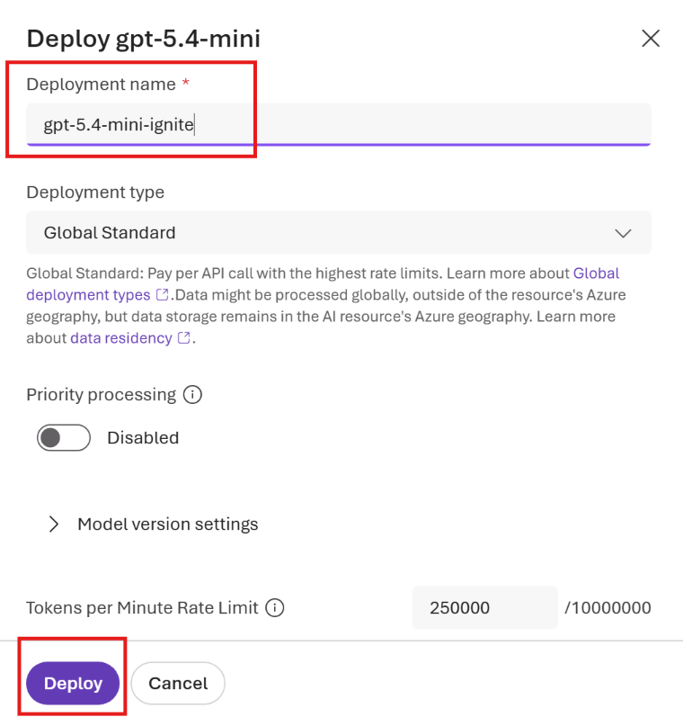

   > The value `gpt-5.4-mini-ignite` is already set in the `.env` file. If you use a different deployment name, please update the `.env` file.

6. [ ] Close the Edge Browser for Azure Admin.

---

Congrats, you just connected your agent to a model! :tada:

---

**Please proceed to the next section.**

---

## Exercise 1: Bring Your Agent to Microsoft Teams

In this exercise, you will:

1.  Set up Teams CLI
2.  Create a Teams app registration
3.  Sideload your agent in 1:1 chat

---

### Step 1: Set up Teams CLI

> In the following steps, you will start using the Teams CLI. Teams CLI is a collection of tools available to help developers build and modify their agent settings without having to leave their development environment. It also allows programmatic access to these tools via coding agents.

1. [ ] Open the Microsoft Edge profile for `PattiF` from the **Start Menu**.

   > If Edge displays this notification, click 'Got it'.

   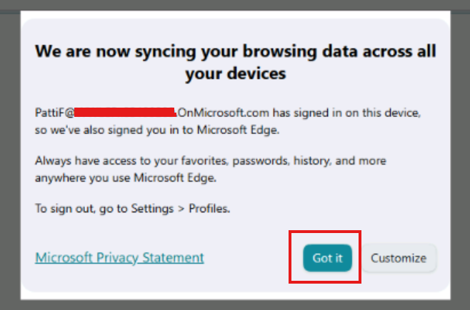

2. [ ] Navigate to `portal.office.com`

   If prompted, log in with:

   `PattiF@@lab.CloudCredential(WWLM365E7).TenantName`

   Authenticate using the following TAP (Temporary Access Pass):

   `@lab.CloudCredential(WWLM365E7).PattiFTAP`

   Once you have signed in as `PattiF`, **close the browser**.
   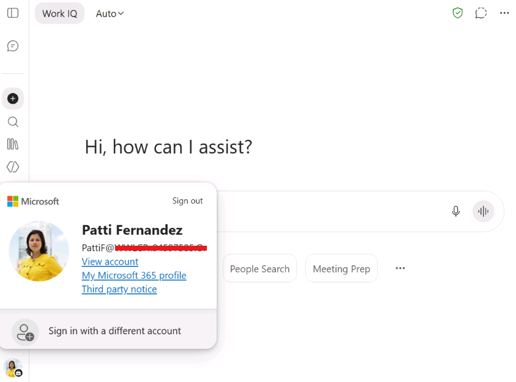

---

1. [ ] Open **Terminal** from the **Start Menu**.

2. [ ] Run the following command to log in to Teams CLI:

   `teams login`

   It should open the browser and log you in automatically. If prompted, use the credentials from **Step 1**.

   > When the browser _says Authentication successful!_, you can close the browser

3. [ ] Run the following command to log in to Azure CLI (you can use the same terminal):

   `az login --allow-no-subscriptions`

   > Teams CLI uses resources across your tenant and Azure subscriptions. We log in to all these services so the CLI can take action across services and save developers the headache of working in multiple systems.

4. [ ] Select the following user and continue:

   `PattiF@@lab.CloudCredential(WWLM365E7).TenantName`

   > If prompted for a TAP, use the following: `@lab.CloudCredential(WWLM365E7).PattiFTAP`

5. [ ] After logging in, you should see Select Subscription.

   > Select a subscription and tenant (Type a number or Enter for no changes):

   Press Enter and continue

---

### Step 2: Create a Teams app registration

> The agent in this demo uses a bot registration behind the scenes. Your Client ID and Secret are tied to your bot registration and bridge the connection between your running code and the bot registration.

1. [ ] Run the following command to launch the Teams CLI:

   `teams app`

2. [ ] Select **Create App**. (↑↓ navigate • ⏎ select)
3. [ ] Enter `Zava-Help-Desk` as the app name.
4. [ ] **How should Teams deliver messages to your app?** : Select [**by pressing Enter**]

   _Sockets (Easy to get started, best for local development)_

5. [ ] Path to credentials file : **Do not type anything, press ENTER and continue**

6. [ ] Advanced options? : **Do not type anything, press ENTER and continue**

7. [ ] Confirm creation? : **Type Y and ENTER**

   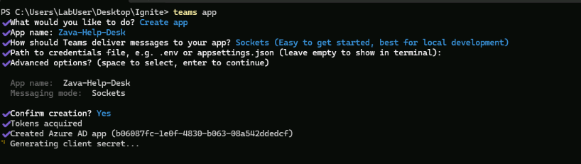

8. [ ] Wait for the app process to complete. Copy the generated output values into the `.env` file in your codebase.

   ```dotenv
   CLIENT_ID=generated_client_id
   CLIENT_SECRET=generated_client_secret
   TENANT_ID=generated_tenant_id
   ```

   Replace the placeholders with the actual values generated by the CLI.

   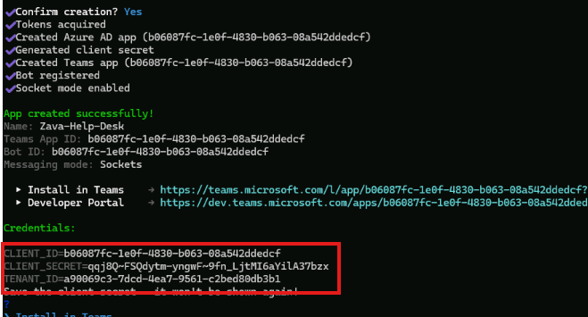

9. [ ] Update the `.env` file in VS Code.

   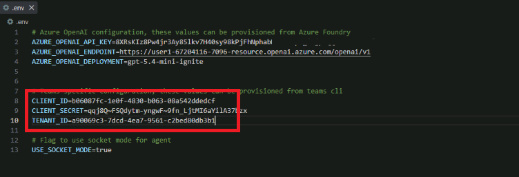

   > **Tip:** Remember to save the `.env` file after making any updates by pressing `Ctrl + S`.

10. [ ] After updating the environment variables, start the server by running the following command in the VS Code terminal:

    `npm run dev`

    > **Tip:** The terminal should already be open in VS Code. If not, open it by pressing **Ctrl + Backtick**.

11. [ ] Wait ~1 minute until the terminal displays:

    `Socket Mode ready (inbound activities over WebSocket)`

12. [ ] Go back to the Teams CLI and select **Install in Teams**. This should launch Teams in the browser.
13. [ ] Select **Use the web app instead**.
14. [ ] Sign in using the following username (If prompted):

    `PattiF@@lab.CloudCredential(WWLM365E7).TenantName`

    Authenticate using the following TAP (Temporary Access Pass):

    `@lab.CloudCredential(WWLM365E7).PattiFTAP`

15. [ ] Select Add to add the agent in Teams. Once added, click `Open`.

   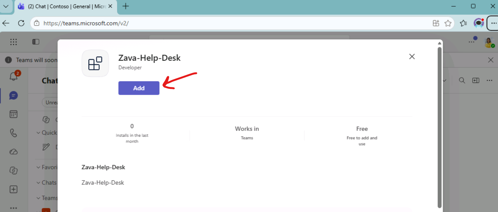

   > **Tip:** If you don't see the **Add** button, wait ~1 minute. Teams might still be loading.

---

### Step 3: Sideload your agent in 1:1 chat

1. [ ] Once the Teams agent loads, test the agent by interacting with it.

2. [ ] Use the following sample prompts:
   - `Hi`
   - `What can you do?`

3. [ ] After completing the tests, do the following:
   - Close the Microsoft Edge browser window.
   - Close the terminal window running the Teams CLI.
   - In VS Code, stop the locally running agent process by pressing `Ctrl + C` in the terminal.

---

Congratulations, you've taken your agent from running in a local environment to running in Teams :tada: <br>
**Please proceed to the next section.**

---

## Exercise 2: Enable Collaboration

In this exercise, you will:

1.  Create mock data in your M365 Enterprise tenant
2.  Update RSC permissions for your agent
3.  Add your agent to a channel & run your agent
4.  Enable @mentions, thread reading, and summaries
5.  Test external data fetching
6.  Clean up your environment

---

### Step 1: Create mock data in your M365 Enterprise tenant

1. [ ] To test collaborative agents, we need conversations involving multiple users.
2. [ ] The script below will create mock conversations and a Teams channel that will be used in later steps.
3. [ ] Open a new terminal from the **Start Menu**.
4. [ ] Run the following PowerShell script:

   `.\helper_scripts\Create-TeamConversation.ps1`

5. [ ] When prompted for details, enter the following username:

   `PattiF@@lab.CloudCredential(WWLM365E7).TenantName`

6. [ ] You can proceed to the next step while the script continues running in the background. Do not close this terminal until the script finishes. This takes ~2 minutes.

   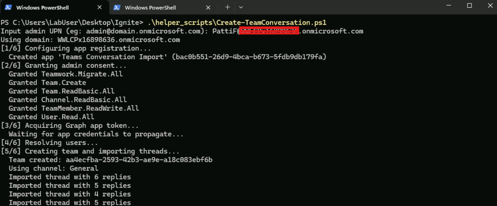

---

### Step 2: Update RSC permissions for your agent

> In this step, adding RSC permissions to your agent allows it to view and interact with messages in channels. By default, agents can only see messages where the agent has been @mentioned. RSC helps expand that to allow the agent to see all messages in a channel without granting access to every message in your organization.

1. [ ] Open a New Terminal Tab

   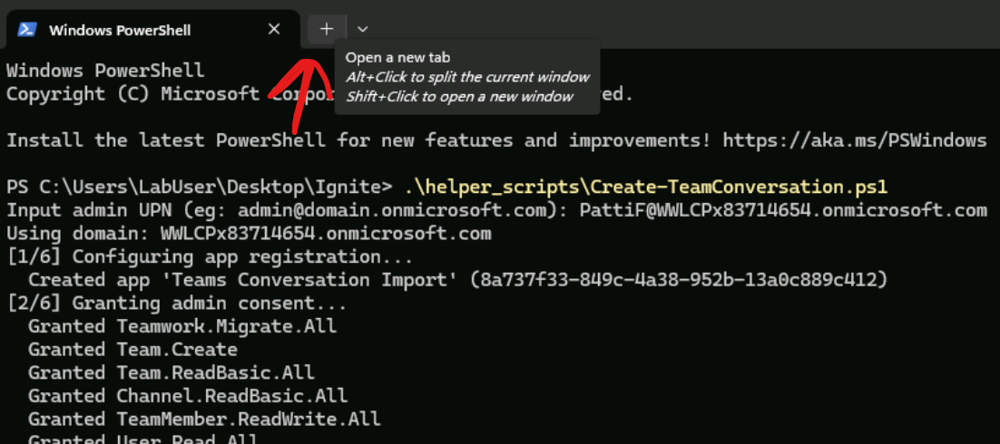

2. [ ] Launch the Teams CLI by running:

   `teams app`

3. [ ] Navigate to **Select App**.

4. [ ] Select `Zava-Help-Desk`

5. [ ] Navigate to **Permissions (RSC)**. You can use ↑↓ navigate • ⏎ select

6. [ ] Select **Edit Team Permissions**.

7. [ ] Add the following permissions (see the hint below on how to add these easily):
   - `ChannelMember.ReadWrite.Group`
   - `ChannelMessage.Read.Group`
   - `ChannelMessage.Send.Group`

   > **Tip:** The permissions are in the 9th, 10th, and 11th positions. Press 9 to jump to the 9th position, then select that permission (using space) and the next two. Use ↑ / ↓ to navigate, Space to select each permission, and Enter to submit once all three permissions are selected.

   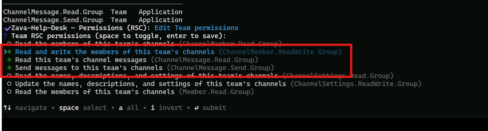

8. [ ] Apply the RSC permissions by entering _Y_.

---

### Step 3: Add your agent to a channel & run your agent

> This step may seem repetitive. Every time you change permissions on your agent, it needs to be restarted and reinstalled to grant the new permissions.

1. [ ] In the same CLI, navigate **Back** > select **Get App Details**.

2. [ ] Select **Install in Teams**. This will launch the browser. Select **Use the web app instead**.

3. [ ] Install the app in the **Ignite Demo Team**.

   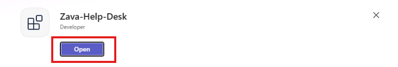

   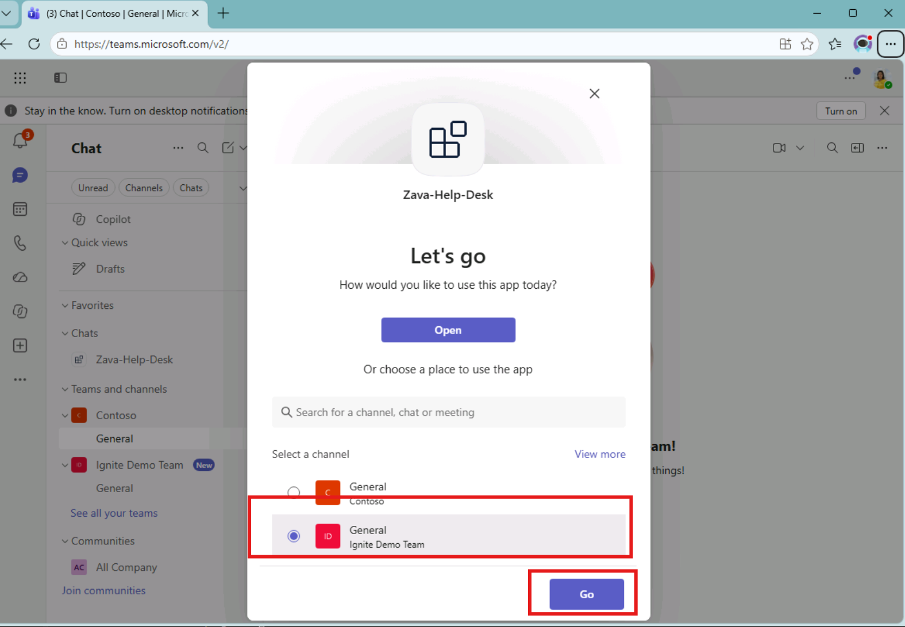

4. [ ] Minimize Edge and open **VS Code**

5. [ ] In the Terminal, start the server by running

   `npm run dev`

6. [ ] Wait ~1 minute until the terminal displays:

   `Socket Mode ready (inbound activities over WebSocket)`

---

### Step 4: Enable @mentions, thread reading, and summaries.

1. [ ] Go back to Edge and open the **Ignite Team**, which already contains conversation threads.
2. [ ] Navigate to the top of the messages.

   > **Tip:** You can maximize a thread by clicking _Open X replies_
   > 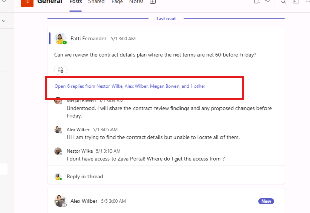

3. [ ] Start by @mentioning the agent in a Teams thread.

   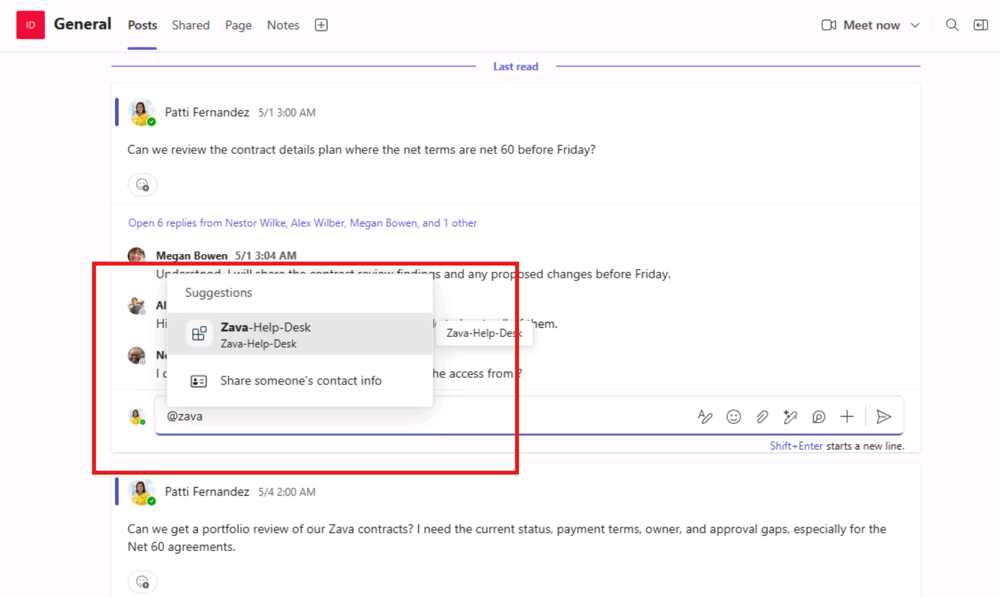

4. [ ] In the thread titled _"Can we review the contract....."_, ask the agent to summarize the conversation and provide the next steps. Use the following prompt (press Send after typing the prompt):

   `Can you summarize this thread and give the next steps ?`

   > **Tip:** Make sure to @mention and resolve the agent name before entering this prompt.
   > 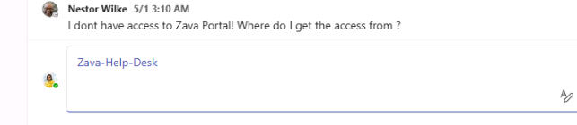

5. [ ] The agent should acknowledge the message by replying with an emoji.
6. [ ] Once processing is complete, the agent will reply with a summary of the conversation.

   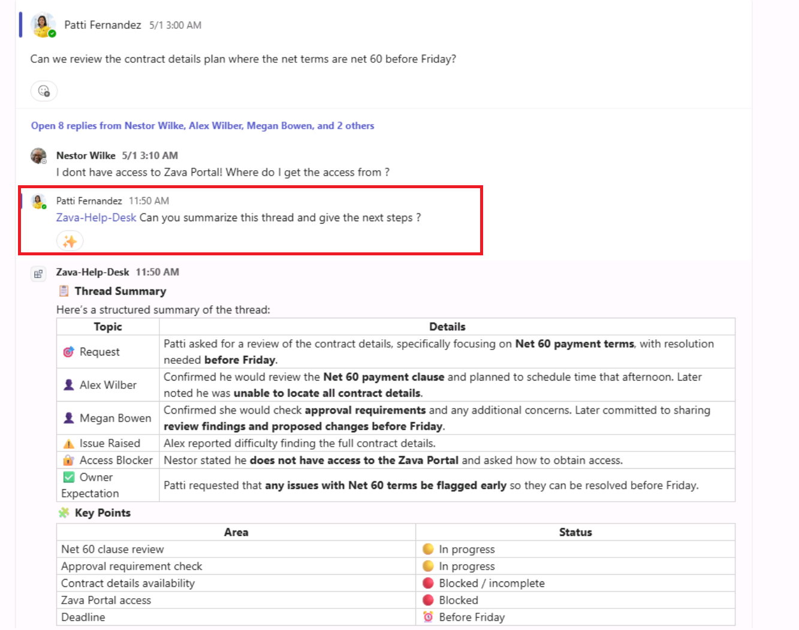

---

### Step 5: Test external data fetching

1. [ ] In the same conversation thread, @mention the agent and ask it to fetch the contract details using the following prompt:

   `Can you fetch net-60 Contract Details from Zava System ?`

   > **Tip:** Make sure to @mention the agent and select its name from the suggestions before submitting the prompt.

2. [ ] The agent **should refuse** this request because it is not yet connected to an external MCP server.

   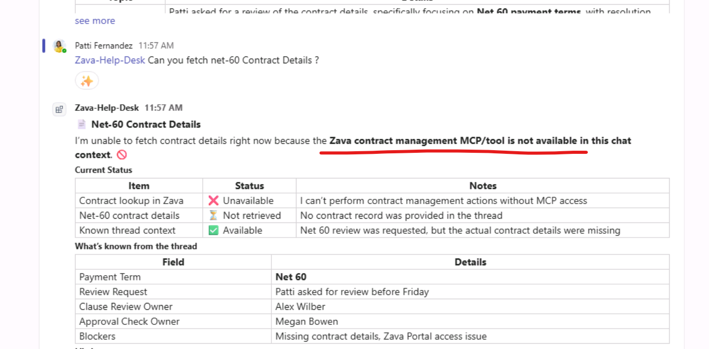

   > **Tip:** This is expected behavior, as we've defined the agent's instructions in `src\azureOpenAi\agentInstruction.md`. If the agent cannot retrieve external information, it should not hallucinate or make things up. In the next exercise, we'll connect the agent to MCP.

---

### Step 6: Cleanup

1. [ ] After completing the tests, perform the following cleanup steps:
   - **Minimize** the Edge window for PattiF.
   - Close the terminal window running the Teams CLI.
   - Close the terminal window running the Helper Conversation Script.
   - In VS Code, stop the locally running agent process by pressing **Ctrl + C** in the terminal.

---

---

## Exercise 3: Connect the Agent to External Tools

In this exercise, you will connect the agent to an MCP server to enable it to interact with the Contract Management System.

---

### Step 1: Explore the Contract Management System

> Zava Contract Services is an MCP server running locally on your machine. Outside of this lab, you would use a public MCP server or one you create and host yourself to enable the use of available MCP tools.

1. [ ] Open the **Start Menu** and launch **Zava Contract Services**.

   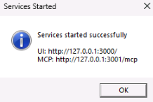

2. [ ] Open a new tab in the browser and navigate to `localhost:3000`
3. [ ] Explore the UI of the Contract Management application and make sure you can see the list of contracts.

   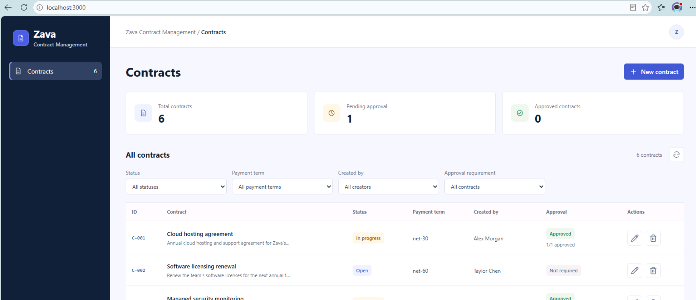

---

### Step 2: Connect the MCP Server to the Agent

> In this step, the connection to the MCP server has been written for you (lines 20 & 21). Uncommenting the code allows the agent to connect now that you have started the server in Step #1 above.

1. [ ] Open the agent codebase in VS Code.
2. [ ] Open the `index.ts` file.
3. [ ] Uncomment lines 20 and 21 to connect the MCP server to the application.

   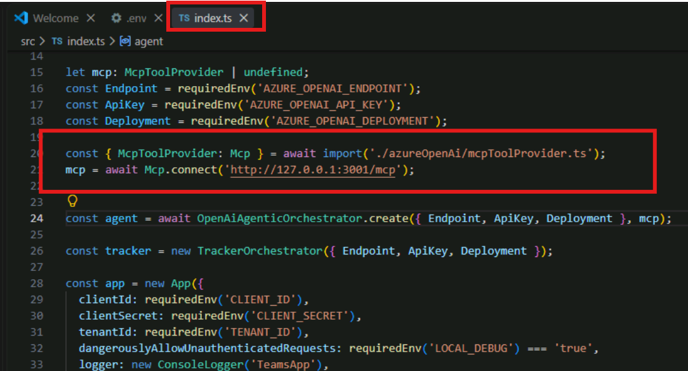

4. [ ] Save the file (use CTRL + S).
5. [ ] Start the server by running the following command in the terminal:

   `npm run dev`

6. [ ] Wait ~1 minute until the terminal displays:

   `Socket Mode ready (inbound activities over WebSocket)`

---

### Step 3: Fetch Contracts from an External Source

> In this step, we are explicitly telling our agent to use the MCP tools available to it. This helps us ensure consistency in the lab environment. Outside of this lab, your agent will reason over requests and decide whether using MCP tools makes sense in those cases.

1. [ ] Return to the same thread from the previous exercise, where the agent was unable to fetch the contract details.
2. [ ] Ask the agent to fetch the details again using the prompt shown below.

   `try again and fetch net-60 details, retry the tool call`

   > **Tip:** Make sure to @mention the agent and select its name from the suggestions before submitting the prompt.

   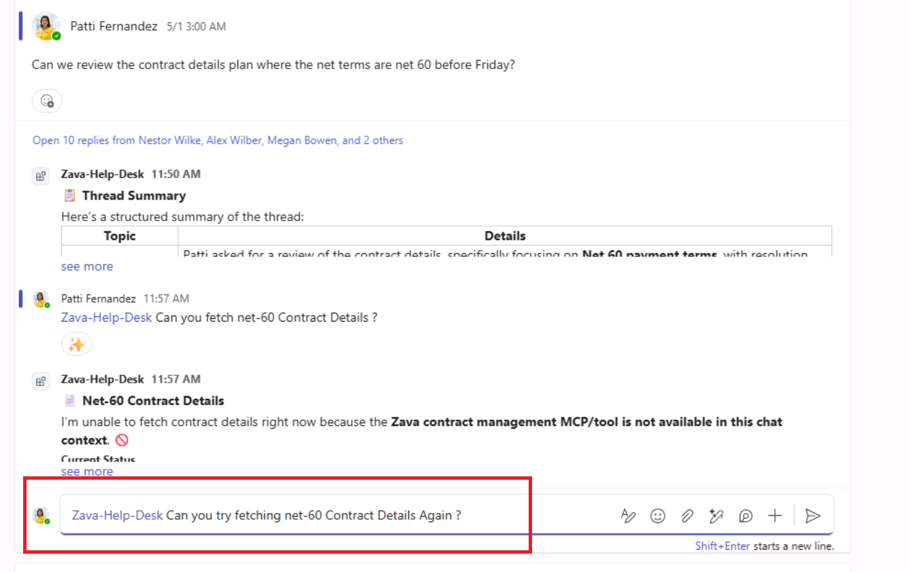

3. [ ] This time, the agent should be able to fetch the contract details from the contract management system.

   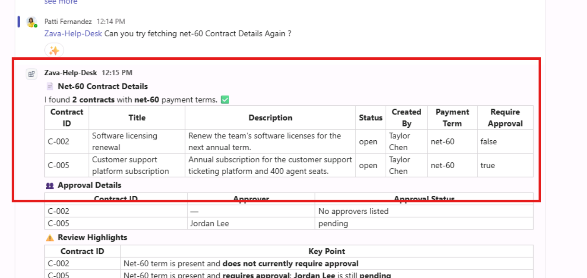

4. [ ] **(Optional)** Open the UI in a separate tab by navigating to `localhost:3000`. Verify the accuracy of the retrieved details by comparing the Net-60 contract details displayed in the UI with the data retrieved by the agent.

---

### Step 4: Create New Contracts

1. [ ] Look for the thread in the channel created by **Alex Wilber**.
2. [ ] @mention the agent and ask it to create a new contract item using the following prompt:

   `Can you create a new contract item for this request and update here ?`

   > **Tip:** Make sure to @mention the agent and select its name from the suggestions before submitting the prompt.

   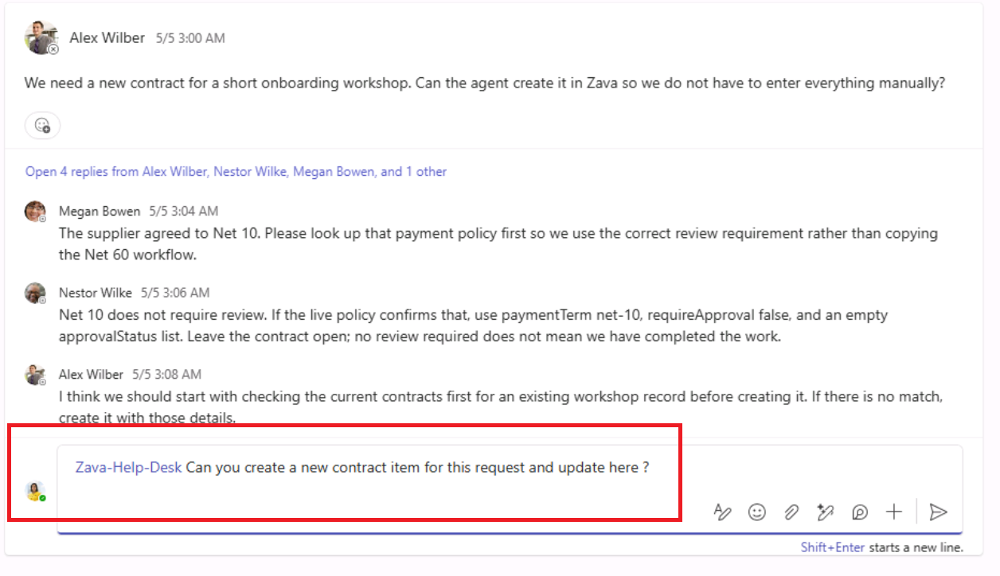

3. [ ] The agent should create a new item and respond in the thread.

   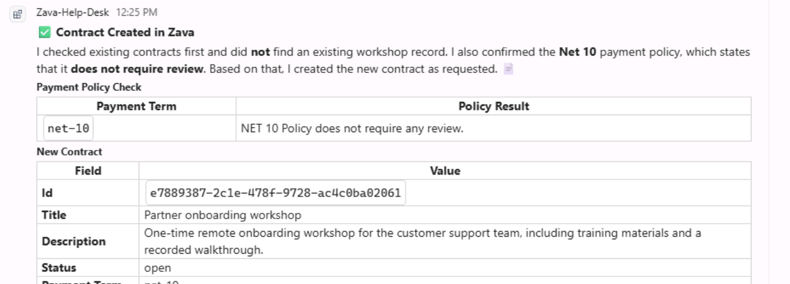

4. [ ] **(Optional)** Open the UI in a separate tab to verify that the item was created successfully. Open `localhost:3000` and verify the new item.

   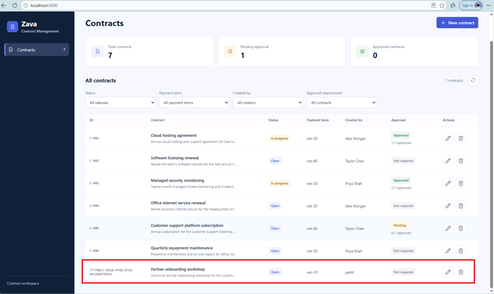

---

---

## Exercise 4: Generate Interactive Adaptive Cards

In this exercise, you will enhance the agent to generate interactive Adaptive Cards in Microsoft Teams. When you @mention the agent and ask it to create a card, it will render an interactive card that users can interact with and update dynamically.

The card will contain 5 action items based on the thread context, and users will be able to update the card in real time.

---

### Step 1: Test Interactive Adaptive Cards

> In this step, we'll use different accounts so you can see how adaptive cards can be utilized by users across your organization.

1. [ ] Find the thread in the channel created by **Megan Bowen**.
2. [ ] @mention the agent and enter exactly `card`

   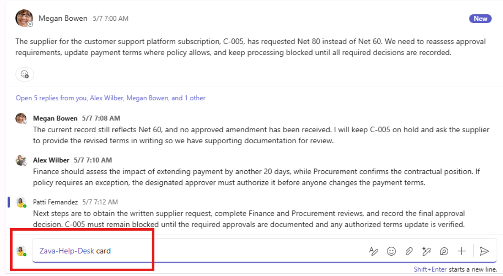

3. [ ] The agent should respond with an interactive Adaptive Card.

   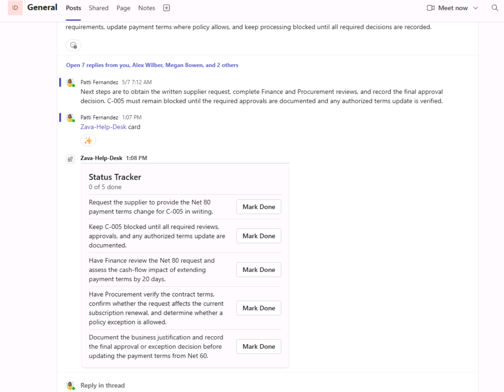

4. [ ] Interact with the generated card by clicking the buttons. The card should update to mark the selected items as **Done**.

5. [ ] From the **Start Menu**, open the Microsoft Edge profile for `AlexW` and navigate to Teams using the following URL:

   `https://aka.ms/mstfw`

6. [ ] Sign in using the following credentials:

   - **Username:** `AlexW@@lab.CloudCredential(WWLM365E7).TenantName`
   - **TAP:** `@lab.CloudCredential(WWLM365E7).AlexWTAP`

   Skip any Teams messages prompting you to install the app or complete the getting-started steps.

7. [ ] Navigate to the same team, **Ignite Demo Team**, and interact with the card.

8. [ ] Notice how updates made to the card by one user are reflected for the other user as well.

   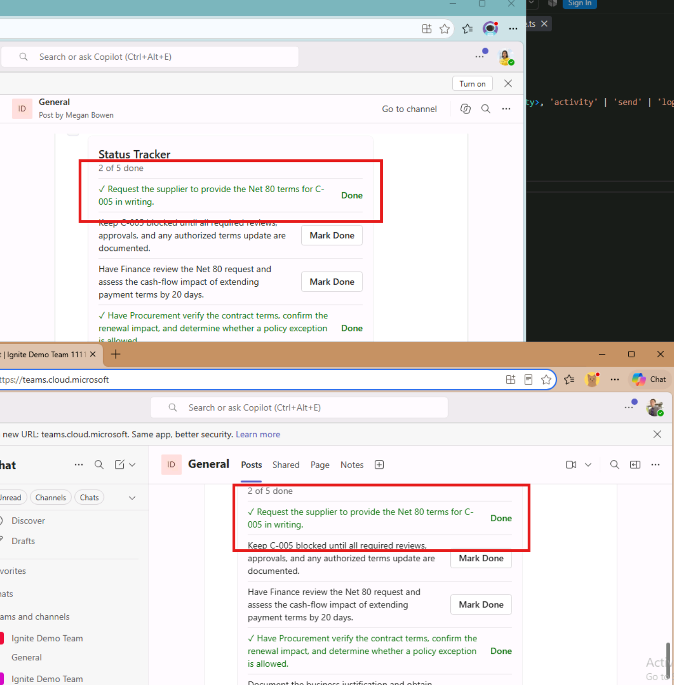

---

### Step 2: Explore Adaptive Card Rendering logic

1. [ ] Open the agent codebase in VS Code and navigate to `statusTrackerCard`, where the Adaptive Card rendering logic is already implemented. Review the files in this folder to understand how the functionality is organized and identify the components involved in preparing and displaying the card.

2. [ ] Open `eventHandler.ts` and look around line 62 for the logic that handles the `card` prompt. Examine how the incoming message is checked and follow the function call that routes the request to the status tracker flow.

3. [ ] Open `trackerOrchestrator.ts` and review the functions invoked by the event handler. Follow their execution order to understand how the orchestrator coordinates the flow and passes information to the card rendering components.

4. [ ] Follow the relevant calls into the rendering logic inside `statusTrackerCard`. Explore how the card's layout, content, and displayed values are assembled, then trace how the completed card is returned or sent to the conversation.

---

---

## Exercise 5: Send Targeted Messages from Adaptive Card Interactions

In this exercise, you will enhance the agent to send targeted messages when a user interacts with an Adaptive Card in Microsoft Teams. The response should be visible only to the user who performed the action, without notifying other participants in the conversation.

---

### Step 1: Explore the Targeted Messaging Logic

1. [ ] In VS Code, stop the running server by pressing **Ctrl + C** in the terminal.
2. [ ] Open `src\statusTrackerCard\statusTrackerCard.ts` and uncomment **line 85**.

   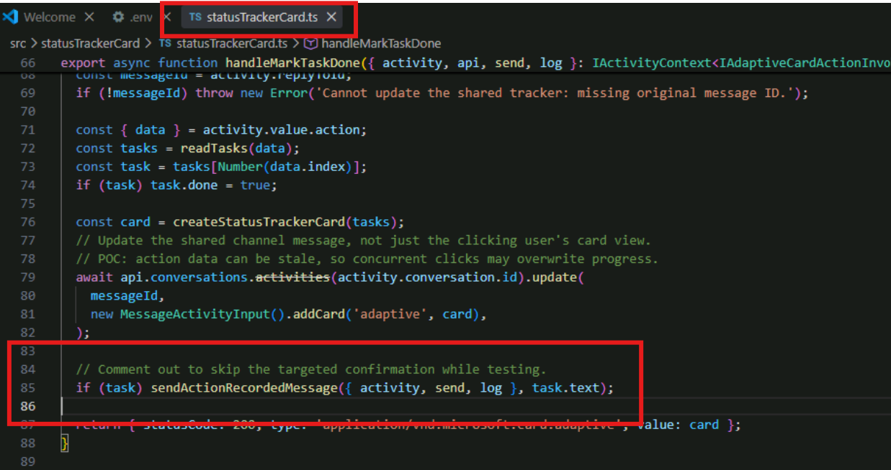

3. [ ] The implementation for targeted messaging is already available in `src\targetedMessage\sendActionRecordedMessage.ts`.
4. [ ] Start the server by running the following command in the terminal:

   `npm run dev`

5. [ ] Wait approximately one minute for the terminal to display:

   `Socket Mode ready (inbound activities over WebSocket)`

---

### Step 2: Test Targeted Messages

1. [ ] Have either user interact with the card again.

2. [ ] After the interaction, a targeted message should be posted. This message should be visible only to the user who interacted with the card.

3. [ ] Verify this with the other user. The targeted message should not be visible to them.

   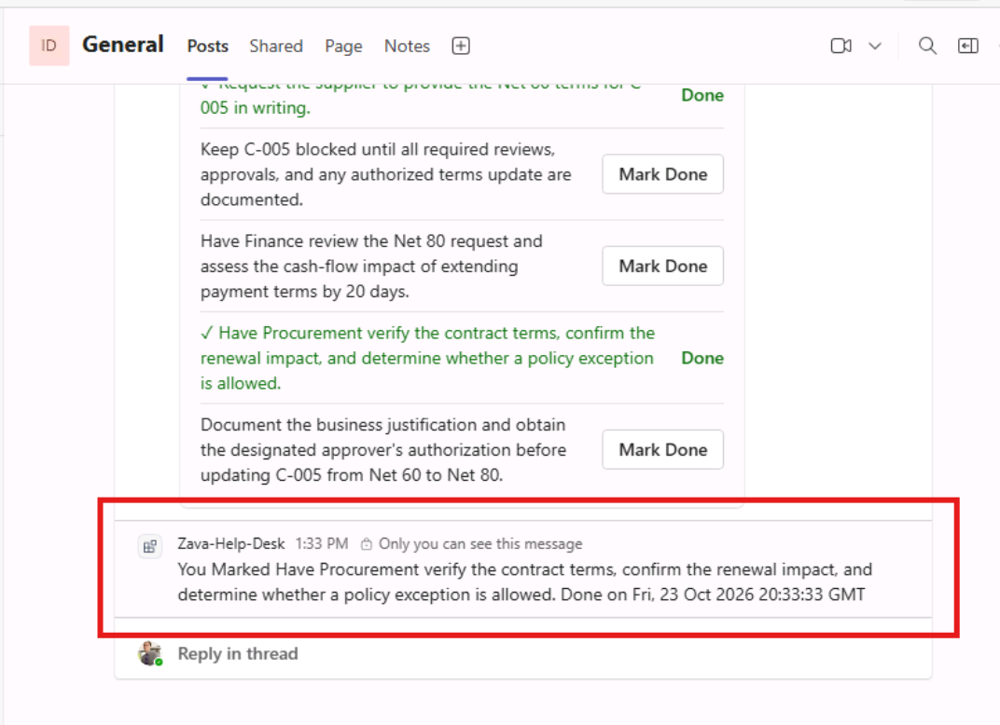

---

---

## Exercise 6: Render HTML Widgets

In this exercise, you will enhance the agent to render an HTML widget to bring a custom HTML interface into a conversation.

---

> HTML widgets are a preview feature. The Teams SDK marks the related APIs as experimental, and they may change.

### Step 1: Enable Preview Features

1. [ ] On the Teams client, click the three dots (⋯) next to your profile picture, then navigate to Settings.

   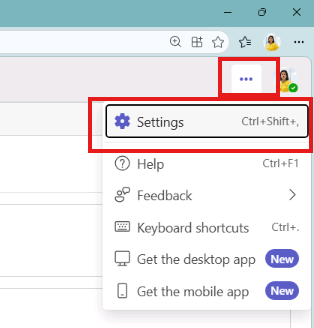

2. [ ] Go to About Teams and check the "Public Preview" checkbox.

   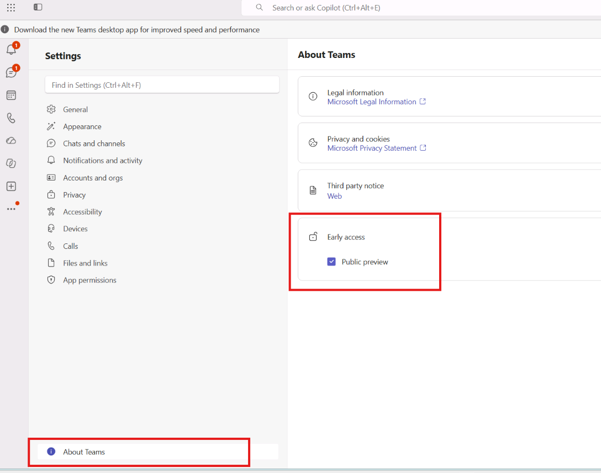

3. [ ] Once the box is checked, open the URL below in the same browser tab. This will refresh Teams.

   `https://teams.cloud.microsoft/?ring=ring3_6`

   Teams is now enabled for preview features.

---

### Step 2: Test the HTML widget

1. [ ] Navigate to the Ignite Demo Team
2. [ ] In any thread @mention the agent and enter exactly `widget`

   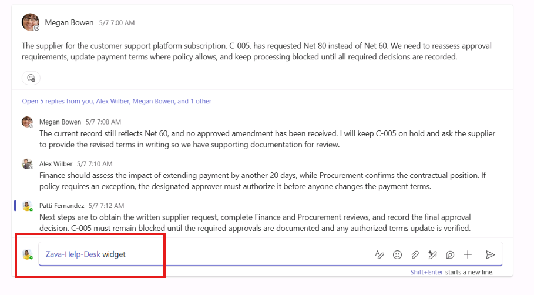

3. [ ] The agent should render an HTML widget.

   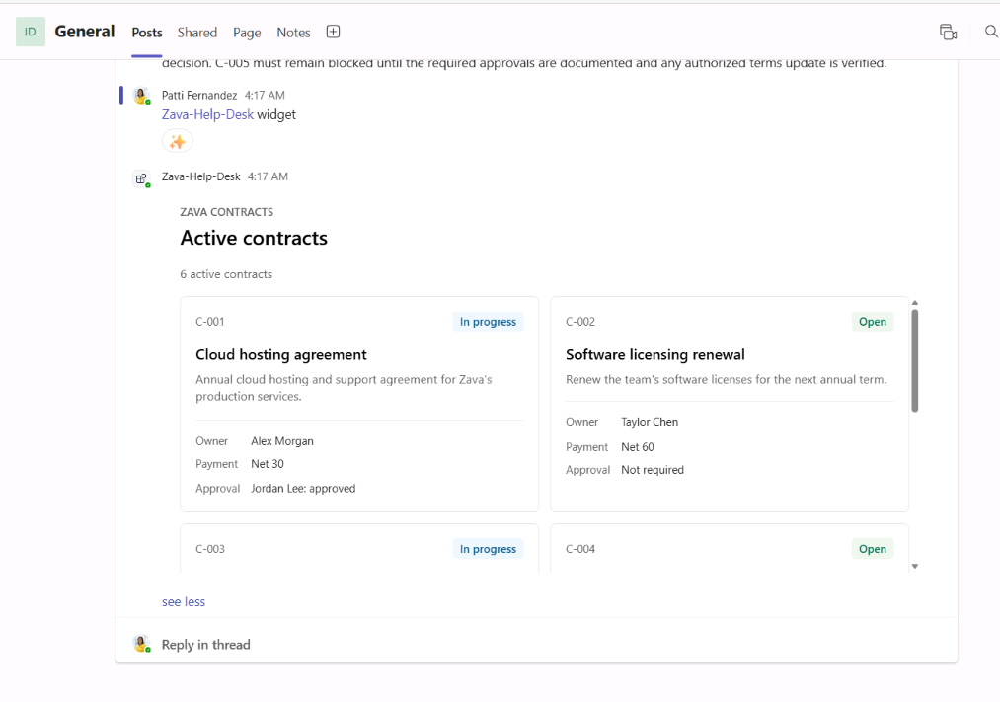

---

### Step 3: Explore Widget Rendering logic

1. [ ] Triggered by widget: When a channel @mention contains exactly widget after removing mentions, `eventHandler.ts:74` calls `createMcpWidgetMessage()` and sends its response.

2. [ ] Fetches data and HTML: `widgetHtmlMcp.ts:6` connects to the local MCP server at `http://127.0.0.1:3001/mcp`, calls its widget tool, and reads the HTML resource `ui://widget/active-contracts.html`.

3. [ ] Packages the Teams widget: It combines the HTML, tool output, MCP URL, and security policy into a widget/mcp-ui payload. It serializes this into an html-widget code block within an extended-Markdown Teams message.

4. [ ] Handles failures and cleanup: If connecting, fetching, or processing fails, it returns a plain-text message asking users to ensure Zava Contract Services are running. It always attempts to close the MCP client afterward.

---

---

## Conclusion and Key Takeaways

Congratulations! You've successfully completed Lab 651: Build AI Agents in Teams. :tada:

In this lab, you accomplished the following:

- Built a **Microsoft Teams agent** that evolved from a local prototype into a collaborative teammate capable of working directly within Teams conversations.

- Configured an **Azure OpenAI** LLM resource on **Microsoft Foundry** and integrated the resource into your agent.

- Used the **Teams CLI** and **Dev Tunnel** to create, configure, sideload, and test the agent in Microsoft Teams.

- Used **Socket Mode** to connect your agent to Teams during development.

- Enabled collaboration through **Resource-Specific Consent (RSC)** permissions, allowing the agent to participate in channels, read conversation threads, respond to @mentions, and generate contextual summaries and next steps.

- Connected the agent to an external **Contract Management System using MCP**, enabling it to retrieve contract information and create new contract records from natural-language requests.

- Implemented **Adaptive Cards** that transform conversation context into a shared five-item checklist that multiple channel members can interact with and update in real time.

- Explored how Adaptive Card events are orchestrated, rendered, and synchronized across users.

- Added **Targeted Messaging**, enabling the agent to acknowledge individual users' card interactions privately without notifying other channel members.

- Added an **HTML widget**, enabling the agent to send an HTML document that Teams renders in a sandboxed iframe inside a chat message.

Today's lab gives you hands-on experience building collaborative agents while giving you a reusable base agent you can customize to meet your business needs.

---